```{r}
#| label: setup
#| include: false

pacman::p_load(dplyr, knitr, rstan, loo, brms)
```

## 学习目标

- 用真实实验的数据，对照贝叶斯回归和普通最小二乘回归（OLS）的参数估计。
- 区分研究设计的公正性、模型假设的适切性和样本外预测表现。
- 计算绝对误差的中位数（MedAE）、ELPD-LOO 和 DIC，并说明它们各自回答的问题。

---

## Part1：回顾自我匹配实验

第 10 讲用 RStan 建立了三个线性回归模型。对于同一批自我匹配实验数据，贝叶斯回归与传统 OLS 会得到一致的参数估计吗？哪一个模型对新数据的预测最好？

## 三个候选模型

反应变量是各被试在相应条件下的平均反应时（RT，秒）。

| 模型 | R 公式 | 预测因子 |
|:---|:---|:---|
| 模型 1 | `RT_sec ~ Label` | 标签（自我、朋友、陌生人） |
| 模型 2 | `RT_sec ~ Label + Matching` | 标签与匹配状态的主效应 |
| 模型 3 | `RT_sec ~ Label * Matching` | 两个主效应及其交互作用 |

## 汇总实验试次

每个被试在每种标签与匹配状态的组合下贡献一个平均 RT。同一被试的多个条件均值仍可能相关。

```{r}
#| label: rt-data

rt_trials <- utils::read.csv("data/Kolvoort_2020_HBM_Exp1_Clean.csv")
rt <- rt_trials %>%
  dplyr::group_by(Subject, Label, Matching) %>%
  dplyr::summarise(RT_sec = mean(RT_sec), .groups = "drop") %>%
  dplyr::mutate(
    Label = factor(Label, levels = 1:3, labels = c("Self", "Friend", "Stranger")),
    Matching = factor(Matching, levels = c("Matching", "Nonmatching"))
  )
utils::head(rt, 3)
```

---

## 从模型公式到设计矩阵

- `Self` 是三个模型的标签基线。模型 2 和 3 以 `Matching` 为匹配状态基线，截距对应自我标签且匹配的条件。
- `LabelFriend` 与 `LabelStranger` 分别编码相对于自我标签的差异。
- 模型 3 的交互项由相应的标签和匹配哑变量相乘得到。

```{r}
#| label: rt-design

rt_formulas <- list(
  model1 = RT_sec ~ Label,
  model2 = RT_sec ~ Label + Matching,
  model3 = RT_sec ~ Label * Matching
)
contrast_codes <- list(Label = "contr.treatment", Matching = "contr.treatment")
rt_designs <- lapply(rt_formulas, function(formula) {
  factors <- intersect(names(contrast_codes), all.vars(formula))
  stats::model.matrix(formula, data = rt, contrasts.arg = contrast_codes[factors])
})
utils::head(rt_designs$model3, 3)
```

---

## 查看原始试次与对比编码

检查汇总前的标签、匹配状态与反应时。对比矩阵说明每列表示的条件差异。

```{r}
#| label: inspect-rt-inputs

utils::head(rt_trials[c("Subject", "Label", "Matching", "RT_ms", "RT_sec")])
stats::contr.treatment(levels(rt$Label))
stats::contr.treatment(levels(rt$Matching))
```

## Stan 中的高斯回归

三个模型共用一个 Stan 程序。设计矩阵 $X$ 决定每个模型有哪些预测因子。

$$
Y_i \mid \boldsymbol{\beta}, \sigma
\sim N \bigl((X \boldsymbol{\beta})_i, \sigma^2\bigr)
$$

- `y_rep` 保存每次后验抽样生成的反应时，用于计算 MedAE。
- `log_lik` 保存每次抽样下每条观测的对数似然，用于 PSIS-LOO 和 DIC。

## 高斯回归的 Stan 程序

```{r}
#| label: gaussian-stan

gaussian_stan <- "
data {
  int<lower=1> N;
  int<lower=1> K;
  matrix[N, K] X;
  vector[N] y;
  vector[K] prior_mean;
  vector<lower=0>[K] prior_sd;
  real<lower=0> sigma_rate;
}
parameters {
  vector[K] beta;
  real<lower=0> sigma;
}
model {
  for (k in 1:K) {
    beta[k] ~ normal(prior_mean[k], prior_sd[k]);
  }
  sigma ~ exponential(sigma_rate);
  for (i in 1:N) {
    y[i] ~ normal(X[i] * beta, sigma);
  }
}
generated quantities {
  vector[N] y_rep;
  vector[N] log_lik;
  for (i in 1:N) {
    real mu_i = X[i] * beta;
    y_rep[i] = normal_rng(mu_i, sigma);
    log_lik[i] = normal_lpdf(y[i] | mu_i, sigma);
  }
}
"
```

---

## 展开三个 Stan 模型

令 $F_i$、$S_i$ 分别表示朋友和陌生人条件，$M_i$ 表示不匹配条件。将 $X\boldsymbol{\beta}$ 展开后，三个模型的生成均值如下。

| 模型 | $\mu_i$ |
|:---|:---|
| 1 | $\beta_0 + \beta_1 F_i + \beta_2 S_i$ |
| 2 | $\beta_0 + \beta_1 F_i + \beta_2 S_i + \beta_3 M_i$ |
| 3 | $\beta_0 + \beta_1 F_i + \beta_2 S_i + \beta_3 M_i + \beta_4 F_iM_i + \beta_5 S_iM_i$ |

每个模型都把对应的均值用于似然、后验预测和逐点对数似然。

## 为三个模型指定先验

沿用前一讲示例的先验。正态先验用均值和标准差指定，指数先验用率参数指定。

| 参数 | 先验 |
|:---|:---|
| 截距 $\beta_0$ | 均值 5、标准差 2 的正态分布 |
| 各回归系数 $\beta_j$，$j > 0$ | 均值 0、标准差 1 的正态分布 |
| 残差标准差 $\sigma$ | 率为 0.3 的指数分布 |

**思考**：反应时以秒为单位，这些先验允许哪些典型反应时？可以用先验预测检验来回答。

```{r}
#| label: rt-stan-data

rt_stan_data <- lapply(rt_designs, function(X) {
  list(N = nrow(X), K = ncol(X), X = X, y = rt$RT_sec,
       prior_mean = c(5, rep(0, ncol(X) - 1)),
       prior_sd = c(2, rep(1, ncol(X) - 1)), sigma_rate = 0.3)
})
```

---

## 拟合三个候选模型

每个模型使用 4 条链，每条链迭代 3,000 次，前 1,000 次用于预热。

```{r rt-fits, cache=TRUE, cache.path="tmpdata/lec11_new/", cache.extra=digest::digest(list(gaussian_stan, rt_stan_data, R.version.string, as.character(utils::packageVersion("rstan"))))}
#| results: hide

rt_stan_model <- rstan::stan_model(model_code = gaussian_stan)
rt_fits <- lapply(rt_stan_data, function(model_data) {
  rstan::sampling(rt_stan_model, data = model_data, chains = 4,
                  iter = 3000, warmup = 1000, seed = 84735, refresh = 0)
})
```

---

## 用 OLS 拟合同一个模型

两种分析使用同一批观测和同样的因素编码，因此对应系数可以逐项比较。

```{r}
#| label: rt-ols

rt_ols <- stats::lm(rt_formulas$model3, data = rt, contrasts = contrast_codes)

ols_coefficients <- stats::coef(summary(rt_ols))

ols_ci <- stats::confint(rt_ols, level = 0.95)
```

## 用显式设计矩阵复核 OLS

设计矩阵已包含截距，公式中用 `-1` 去掉额外截距。用同一编码可复核按因素公式得到的回归系数。Python 的 `statsmodels` 也可以拟合同样的 OLS 模型。

```{r}
#| label: ols-explicit-design

X <- rt_designs$model3
ols_matrix <- stats::lm(rt$RT_sec ~ X - 1)
```

## 贝叶斯回归与 OLS 的参数比较

贝叶斯回归报告后验均值、后验标准差与 95% 等尾可信区间。OLS 报告点估计、标准误与 95% 置信区间。

```{r}
#| label: coefficient-comparison
#| echo: false

bayes <- rstan::summary(rt_fits$model3, pars = "beta",
                        probs = c(0.025, 0.975))$summary
interval <- function(lower, upper) sprintf("[%.3f, %.3f]", lower, upper)
coefficient_table <- data.frame(
  parameter = c("截距", "朋友", "陌生人", "不匹配", "朋友 × 不匹配", "陌生人 × 不匹配"),
  posterior_mean = sprintf("%.3f", bayes[, "mean"]),
  posterior_sd = sprintf("%.3f", bayes[, "sd"]),
  credible_interval = interval(bayes[, "2.5%"], bayes[, "97.5%"]),
  ols_estimate = sprintf("%.3f", ols_coefficients[, "Estimate"]),
  ols_se = sprintf("%.3f", ols_coefficients[, "Std. Error"]),
  confidence_interval = interval(ols_ci[, 1], ols_ci[, 2])
)
knitr::kable(
  coefficient_table, format = "pipe",
  col.names = c("参数", "后验均值", "后验 SD", "可信区间", "OLS 估计", "OLS SE", "置信区间")
)
```

---

## 参数不确定性与模型拟合

```{r}
#| label: regression-diagnostics
#| include: false

sigma_summary <- rstan::summary(rt_fits$model3, pars = "sigma",
                                probs = c(0.025, 0.975))$summary
ols_summary <- summary(rt_ols)
ols_f <- ols_summary$fstatistic
```

- 贝叶斯模型的 $\sigma$ 后验均值为 `r sprintf("%.3f", sigma_summary[1, "mean"])` 秒，后验标准差为 `r sprintf("%.3f", sigma_summary[1, "sd"])` 秒，95% 可信区间为 `r interval(sigma_summary[1, "2.5%"], sigma_summary[1, "97.5%"])` 秒。
- OLS 的 $R^2$ 为 `r sprintf("%.3f", ols_summary$r.squared)`，调整后 $R^2$ 为 `r sprintf("%.3f", ols_summary$adj.r.squared)`。整体检验的 $F$ 值为 `r round(ols_f[1], 2)`，$p$ 值为 `r format.pval(stats::pf(ols_f[1], ols_f[2], ols_f[3], lower.tail = FALSE), digits = 3)`。
- OLS 的对数似然、AIC 和 BIC 分别为 `r round(as.numeric(stats::logLik(rt_ols)), 2)`、`r round(stats::AIC(rt_ols), 2)` 和 `r round(stats::BIC(rt_ols), 2)`。

从这些指标能看出在现有样本中的拟合如何。下一步要明确，我们希望模型预测怎样的新观测。

---

## 比较参数与不确定性

- 同一设计矩阵下，两种回归的点估计可以很接近。
- 贝叶斯回归给出后验分布，支持计算后验均值、后验标准差、等尾可信区间及最高密度区间（HDI）。
- OLS 报告点估计、标准误、置信区间和 $p$ 值，也常报告 $R^2$、调整后 $R^2$、$F$、对数似然、AIC 与 BIC。
- 如需比较回归参数的假设，可了解 `bayestestR::bayesfactor_parameters()`，并明确备择假设所用的先验。

---

## Part2： 模型评估与比较

## 从模型拟合到模型比较

这一讲要问，增加预测因子或交互项，能否改善对所关心的新数据的预测？

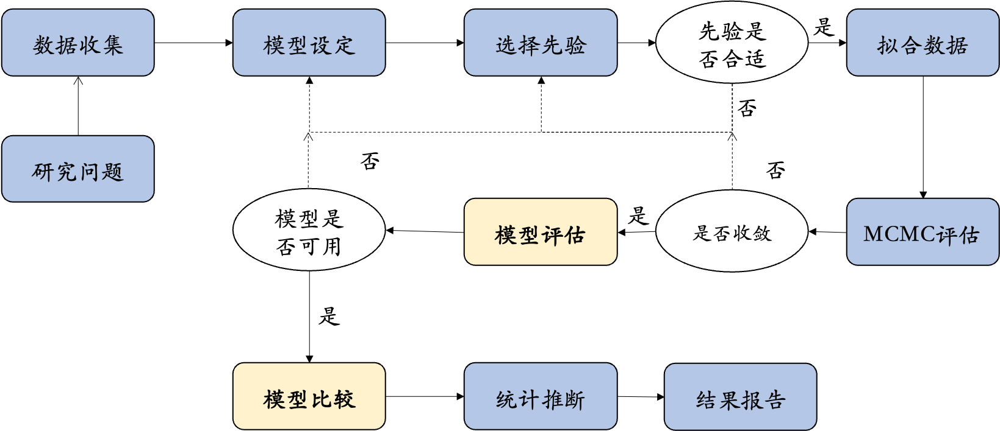{width=78% style="max-height: 475px; object-fit: contain;" fig-alt="原稿的模型比较引导图"}

---

## 模型评估的三个标准

1. **研究过程公正吗？** 招募、测量、分析及结果使用是否考虑了相关人群？
2. **模型假设影响什么？** 隐含模型预设、非线性和方差非齐性会改变哪些解释？
3. **模型能预测哪些新观测？** 增加匹配状态或交互项，是否改善了所关心的样本外预测？

## 为什么要进行模型比较？

模型评估可以针对单一模型，也可以比较多个模型的公正性、可信性与有效性。比较目标随研究问题变化。

| 比较 | 对应的研究问题 |
|:---|:---|
| 模型 2 与模型 1 | 已考虑标签时，匹配状态是否能改善预测？ |
| 模型 3 与模型 2 | 标签效应是否随匹配状态变化？纳入交互项后，预测表现如何？ |

---

## 模型公正吗？

公正性涉及研究过程和结果使用是否符合社会、道德与伦理预期。若特定群体在样本中代表性不足，研究结论的适用范围会受到限制。

原稿指出，自我匹配数据来自线下认知实验，参与者签署知情同意书并获得相应报酬，数据做了匿名化处理。**讨论**：若只招募大学生，基于这些数据得出的推断可以推广到哪些人群？

## 招募、知情同意与样本代表性

- 自我匹配范式的反应时数据来自认知实验。知情同意、参与报酬和匿名化分别涉及参与者权益与隐私。
- 如果样本只来自大学生，结果能否推广到其他年龄、教育和文化背景的人群？
- 样本来源和实验条件应与研究希望解释的人群和情境相对应。

## 研究目的与结果使用

- 谁发起、资助并实施研究？利益冲突可能影响招募、测量与报告。
- 参与者获知的研究目的会不会改变他们在实验中的行为？
- 自我匹配模型可帮助解释个体如何处理与自我相关的信息。若用于个体判断，仍需验证它在目标情境中的表现。

---

## 研究目的与利益冲突

例如，开发缓解压力药物的厂商资助研究时，研究者可能面临选择有利于预期结果的被试、提前透露实验目的等影响。

{width=78% style="max-height: 475px; object-fit: contain;" fig-alt="原稿的研究目的讨论配图"}

---

## 隐含假设怎样影响心理学研究

| 隐含假设或取向 | 对研究的影响 | 可检验的改进方向 |
|:---|:---|:---|
| 假设心理现象跨文化普遍 | 忽略文化背景与测量差异 | 扩大招募范围，检验不同群体中的效应与测量 |
| 偏重特定社会背景中的个体样本 | 样本选择限制理论的适用范围 | 纳入多种社会背景，比较替代解释 |

Bettache (2024) 与 Ghai 等人 (2024) 分别讨论了心理学研究中的隐含取向和大团队研究的可推广性。[Bettache](https://doi.org/10.1177/10888683241287570) · [Ghai 等人](https://doi.org/10.1038/s41562-024-01902-y)

## 内隐哲学观与研究设计

| 内隐观念 | 为什么值得关注 | 可能影响 | 改进方式 |
|:---|:---|:---|:---|
| 普遍性假设与文化差异考量不足 | 理论需要适用于不同文化情境 | 忽略文化因素，限制理论的普适性 | 扩大数据来源，开展文化敏感性培训，形成多元理论视角 |
| 资本主义价值取向与样本偏倚 | 样本需要覆盖多样的社会背景 | 过度依赖西方或资本主义社会中的样本，限制跨文化推断 | 扩大招募范围，比较来自不同文化的解释 |

[Bettache, K. (2024). Where Is Capitalism? Unmasking Its Hidden Role in Psychology.](https://doi.org/10.1177/10888683241287570)

---

## 数据由谁收集，覆盖哪些人群？

从图中能发现哪些覆盖差异？[Ghai, Forscher, & Hu (2024), *Nature Human Behaviour*, 8, 1053–1056](https://doi.org/10.1038/s41562-024-01902-y)

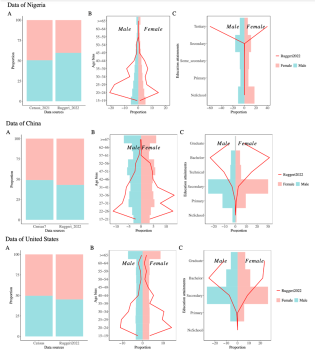{width=78% style="max-height: 475px; object-fit: contain;" fig-alt="大团队研究与可推广性的原稿配图"}

---

## 分析选择与可重复性

- 收集多个因变量，只报告出现目标相关的一个，可能夸大证据。
- 反复增加变量或尝试简单效应分析，会增加发现偶然交互作用的机会。
- 报告分析选择及其依据，区分预先提出的假设与根据数据形成的探索性解释。

延伸阅读：[胡传鹏等人（2016），心理学研究中的可重复性问题](https://doi.org/10.3724/SP.J.1042.2016.01504)。

---

## 公正性与心理学研究的可重复性

讨论选择性报告、*p*-hacking 和 HARKing 如何影响证据。[胡传鹏等人（2016）](https://doi.org/10.3724/SP.J.1042.2016.01504)

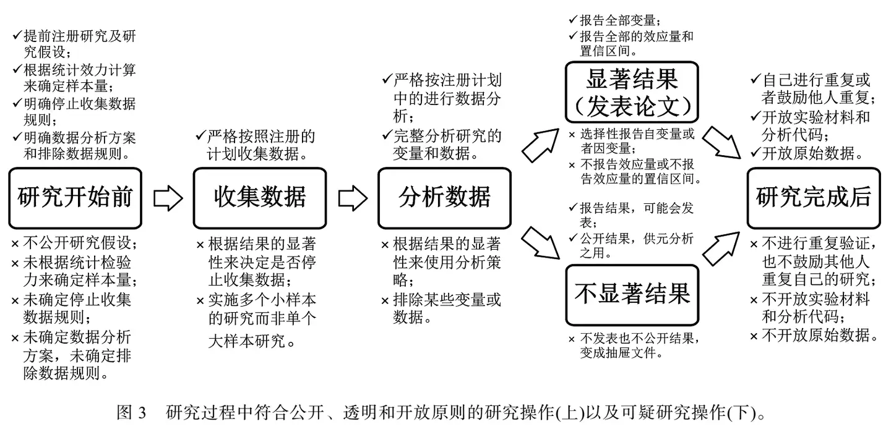{width=78% style="max-height: 475px; object-fit: contain;" fig-alt="心理学研究可重复性的原稿配图"}

---

## 模型可能有多错？

> All models are wrong, but some are useful.  
> — George Box

统计模型简化了现实。以前一讲的标签与反应时模型为例，哪些简化会影响模型对心理现象的解释与预测？

## 高斯线性回归的三个预设(assumptions)

$$
Y_i \mid \beta_0, \beta_1, \sigma
\stackrel{\mathrm{ind}}{\sim} \mathcal{N}(\mu_i, \sigma^2),
\qquad \mu_i = \beta_0 + \beta_1 X_i
$$

1. **条件独立**：给定预测因子与模型参数，观测之间独立。
2. **线性关系**：条件均值 $\mu_i$ 随 $X_i$ 线性变化。
3. **方差齐性**：不同 $X_i$ 水平下的条件方差均为 $\sigma^2$。

## 同一被试的反应可能相关

- 一些被试整体反应更快，一些刺激也可能普遍诱发更快的反应。
- 忽略同一被试或同一刺激内的依赖，可能低估估计的不确定性。
- 层级模型可以用被试随机截距表达不同被试的基线，并在研究设计允许时考虑刺激差异。

---

## 随机截距怎样表达被试差异

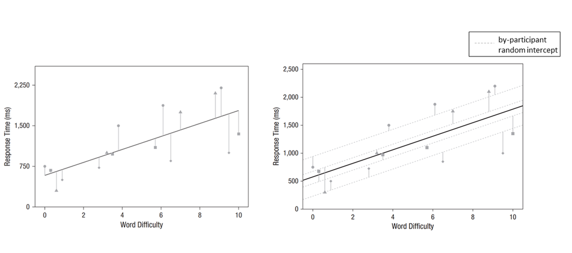{width=62% style="max-height: 450px; object-fit: contain;" fig-alt="总体线性回归与包含被试随机截距的回归比较"}

实线表示群体趋势。加入随机截距后，模型允许不同被试有不同的基线 RT。[Brown (2021)](https://doi.org/10.1177/2515245920960351)

---

## 怎样读随机截距示意图

- 左图用一条总体关系描述反应时，灰色误差条显示观测的变异。
- 右图的虚线显示被试各自的基线，实线显示群体平均趋势。
- 忽略被试内或刺激内的关联可能低估标准误，也可能掩盖个体差异。层级模型可同时表达总体趋势和被试间差异。

## 线性预设违反与方差非齐性

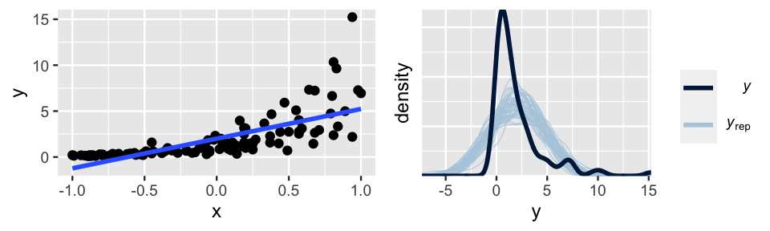{width=65% style="max-height: 465px; object-fit: contain;" fig-alt="线性模型对非线性且异方差数据的拟合和后验预测检验"}

左图中，均值随预测变量呈非线性变化，反应的变异也随预测变量增加。右图用后验预测检验比较模型生成的数据与观测数据。

---

## 如何修改模型

- **根据数据结构建模型**：根据被试、刺激或站点的分组结构建立层级模型。
- **反应分布不适合正态模型**：根据反应变量的测量尺度考虑二项、泊松或负二项回归。
- **均值趋势或残差变异不同**：考虑变换 $X$ 或 $Y$，或者直接为非线性均值趋势、变化的残差标准差建模。

## 通过数据变换

条件分布仍可设为均值 $\mu_i$、方差 $\sigma^2$ 的正态分布。以下写法改变响应或条件均值所在的尺度。

| 变换对象 | 响应 | 条件均值 $\mu_i$ |
|:---|:---|:---|
| $Y$ | $g(Y_i)$ | $\beta_0 + \beta_1 X_i$ |
| $X$ | $Y_i$ | $\beta_0 + \beta_1 h(X_i)$ |
| $X$ 和 $Y$ | $g(Y_i)$ | $\beta_0 + \beta_1 h(X_i)$ |

---

## 对反应变量取对数

当 $Y_i > 0$ 时，可在对数尺度拟合正态回归，再检查变换后线性与方差齐性的适切性。

$$
\log(Y_i) \mid \beta_0, \beta_1, \sigma
\stackrel{\mathrm{ind}}{\sim} \mathcal{N}(\beta_0 + \beta_1 X_i, \sigma^2)
$$


:::: {.columns}

::: {.column width="50%"}
**原始尺度**

{width=95% style="max-height: 315px; object-fit: contain;" fig-alt="变换前的线性拟合与后验预测"}
:::

::: {.column width="50%"}
**对数尺度**

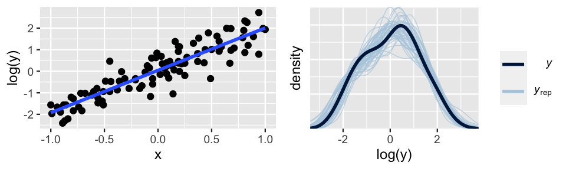{width=95% style="max-height: 315px; object-fit: contain;" fig-alt="变换后的线性拟合与后验预测"}
:::

::::

图中可比较变换前后的均值趋势与残差变异。后续课程将继续讨论不同反应分布的回归模型。

---

## Part3：衡量预测表现

## 样本内拟合与样本外预测

- **样本内**：将已观测的反应时与同一批数据拟合所得的后验预测均值比较。
- **样本外**：评估模型对留出观测的预测。留出单位应与实际预测目标一致，例如新试次、新被试或新站点。
- 时间变化、群体构成差异与重复测量都会影响结果能推广到何处。例如，不同季节测得的压力水平可能不同。

## 绝对误差的中位数（MedAE）

令 $y_i$ 为实际观测，$\widehat y_i$ 为对应后验预测分布的均值。

$$
\operatorname{MedAE} = \operatorname{median}_{i=1,\ldots,n}
\bigl|y_i - \widehat y_i\bigr|
$$

- MedAE 与反应变量使用同一单位，可理解为典型的绝对误差。
- 它对少数极大的误差相对不敏感。用拟合数据计算时，描述的是样本内表现。

---

## 交叉验证的基本思路

例如，用理工科学生的数据拟合后，在心理学学生中检验预测。留出方式取决于研究希望推广到的人群。

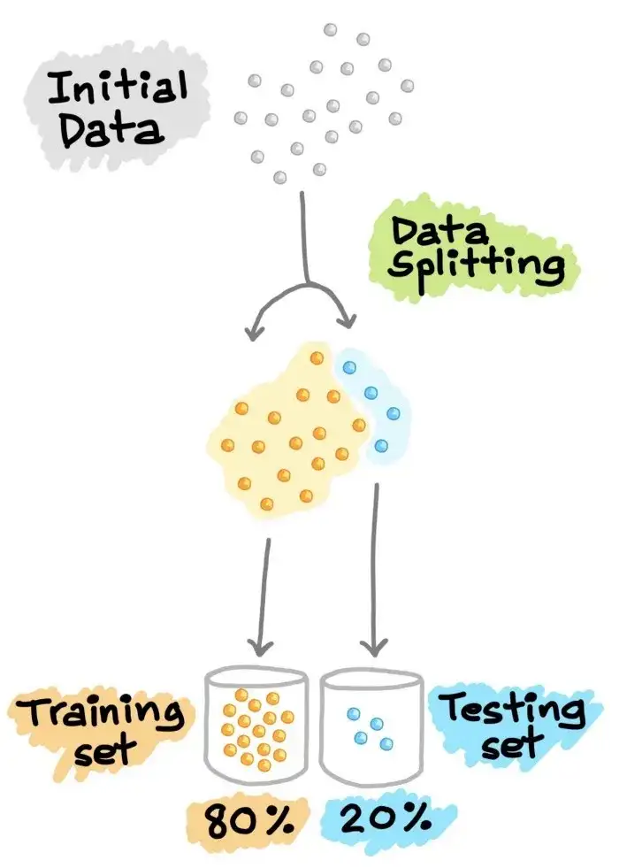{width=78% style="max-height: 475px; object-fit: contain;" fig-alt="从样本中留出部分数据进行验证的原稿示意图"}

---

## 交叉验证如何留出数据

| 方法 | 留出方式 |
|:---|:---|
| 两折交叉验证 | 把数据分为两半，两半轮流作为验证集 |
| $K$ 折交叉验证 | 每次留出一折，使用其余 $K-1$ 折拟合 |
| 留一法（LOO） | 每次留出一个观测，相当于取 $K=n$ |

例如，可把压力与自我控制的数据分成五折，每次在四折上拟合，在剩余一折上计算 MedAE，再汇总五次验证结果。

---

## 五折交叉验证示意

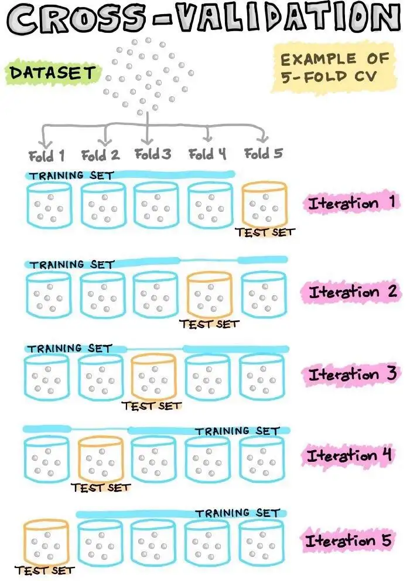{width=68% style="max-height: 520px; object-fit: contain;" fig-alt="每轮轮换留出一折进行验证"}

每一折恰好作为验证集一次。

---

## 留一交叉验证示意

原图以留一组为例。当每折只有一个观测时，就是逐点留一。

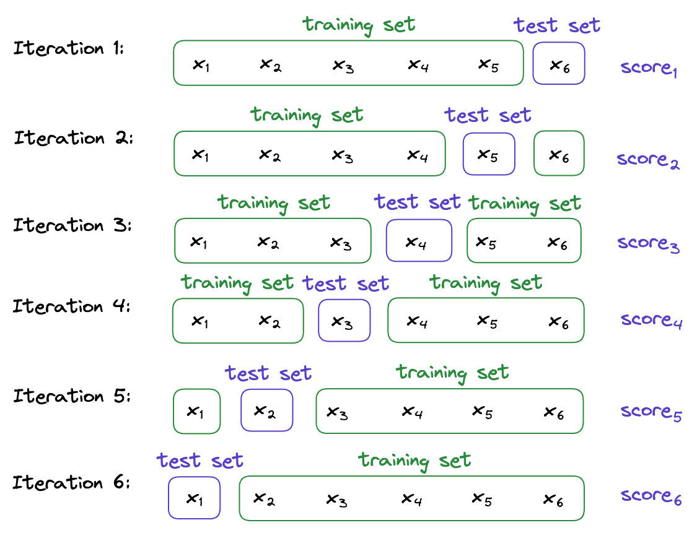{width=78% style="max-height: 475px; object-fit: contain;" fig-alt="每次留出一个验证单位的原稿配图"}

---

## 留出一条观测还是一名被试？

- 用自我匹配数据做逐行 LOO 时，一行是某位被试在某一条件下的平均 RT。
- 留出这一行后，同一被试的其他条件可能仍在拟合数据中。
- 若研究目标是预测新被试，应按被试分组留出；若目标是预测新站点，应按站点分组留出。

## ELPD-LOO

对每个留出的 $y_i$，用其他数据 $y_{-i}$ 得到后验，再求 $y_i$ 的后验预测密度。将各留出预测密度的对数相加。

$$
\widehat{\operatorname{elpd}}_{\mathrm{loo}}
= \sum_{i=1}^n \log p(y_i \mid y_{-i}),
\qquad
p(y_i \mid y_{-i})
= \int p(y_i \mid \theta)\,p(\theta \mid y_{-i})\,\mathrm{d}\theta
$$

PSIS-LOO 用全数据拟合的后验样本近似这一步。对于同一批观测、同一预测单位，ELPD-LOO 越高，估计的样本外对数预测表现越好。

---

## ELPD-LOO 的计算步骤

每轮用其余数据拟合模型，预测留出单位，最后汇总各轮的对数预测得分。

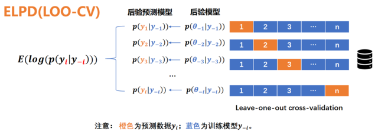{width=78% style="max-height: 475px; object-fit: contain;" fig-alt="逐次拟合并汇总预测得分的原稿配图"}

---

## 其他常见的评估指标

| 指标 | 所回答的问题或计算依据 |
|:---|:---|
| MedAE、MSE、对数似然、$R^2$ | 描述误差或拟合，解释取决于计算所用的数据 |
| AIC | 在最大化对数似然的基础上，按参数个数惩罚 |
| BIC | 在最大化对数似然的基础上，惩罚随样本量而变 |
| DIC | 后验平均偏差加上有效参数个数 |
| WAIC | 用逐点后验预测密度及其后验变异估计预测表现 |
| LOO-CV | 对留出观测评估预测表现 |

延伸阅读：[郭鸣谦、潘晚坷、胡传鹏（2024），认知建模中模型比较的方法](https://doi.org/10.3724/SP.J.1042.2024.01736)。

---

## 各准则如何考虑拟合与复杂度

| 准则 | 适用框架 | 拟合或预测项 | 复杂度或样本外校正 |
|:---|:---|:---|:---|
| AIC | 最大似然 | 最大似然估计处的偏差 | 参数个数 |
| BIC | 最大似然及其贝叶斯近似解释 | 最大似然估计处的偏差 | 参数个数与样本量 |
| DIC | 贝叶斯 | 后验平均偏差 | 有效参数个数 |
| WAIC | 贝叶斯 | 样本内逐点对数后验预测密度（LPPD） | 逐点对数似然的后验方差 |
| LOO-CV | 本例为贝叶斯 | 留出观测的对数后验预测密度 | 留出过程直接评估预测表现 |

---

## 认知建模中的模型比较方法

[郭鸣谦、潘晚坷、胡传鹏（2024），认知建模中模型比较的方法](https://doi.org/10.3724/SP.J.1042.2024.01736)

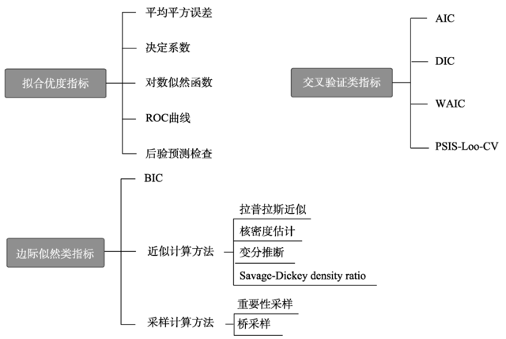{width=78% style="max-height: 475px; object-fit: contain;" fig-alt="郭鸣谦等人的认知模型比较方法图"}

---

## 偏差与方差的权衡

- **偏差**是跨训练样本平均预测值与目标之间的系统差异。
- **方差**是训练样本改变时，模型预测的变动程度。
- **欠拟合**时，模型可能遗漏真实的非线性趋势或交互作用。
- **过拟合**时，模型把当前样本的偶然波动当成可推广的规律。

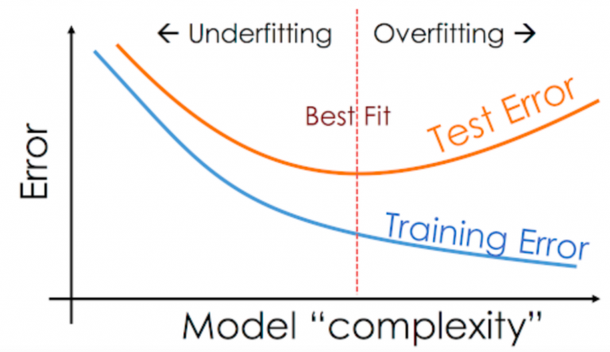{width=52% style="max-height: 340px; object-fit: contain;" fig-alt="模型复杂度与训练误差、样本外误差的关系"}

---

## 欠拟合与过拟合的来源

| 现象 | 样本内外的表现 | 常见原因 |
|:---|:---|:---|
| 欠拟合 | 当前样本和新样本的预测都较差 | 数据缺少关键变量，或模型形式无法表达真实关系 |
| 过拟合 | 当前样本拟合很好，新样本的预测较差 | 样本噪音大、纳入无关变量、样本代表性不足，或模型相对数据过于复杂 |

增加预测因子可能补充原来遗漏的信息，也可能使模型对偶然波动更敏感。简单模型在不同样本之间通常更稳定，复杂模型则可能更敏感地反映样本波动。用留出数据检验这种变化。

---

## 欠拟合、适当拟合与过拟合示意

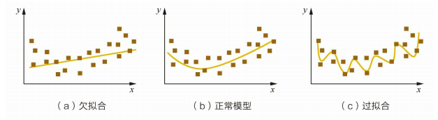{width=78% style="max-height: 475px; object-fit: contain;" fig-alt="原稿中的三种拟合程度示意图"}

---

## 怎样处理欠拟合与过拟合

| 现象 | 可检验的调整 |
|:---|:---|
| 样本内和样本外误差都较高 | 根据理论补充预测因子、非线性项或交互项 |
| 样本内误差较低，样本外误差较高 | 减少不受支持的模型项，使用正则化先验 |
| 验证样本与研究目标人群不同 | 调整招募与留出策略，用更具代表性的数据验证 |

---

## Part4：R 代码演示

## 对每个观测计算后验预测均值

`y_rep` 矩阵的行对应合并各链后的后验抽样，列对应输入数据的观测。每列均值是一条观测的预测值。

```{r}
#| label: predictive-means

predictive_draws <- rstan::extract(rt_fits$model1, pars = "y_rep")$y_rep
predicted_rt <- colMeans(predictive_draws)
utils::head(data.frame(observed = rt$RT_sec, predicted = predicted_rt), 4)
```

---

## 用 tidybayes 整理后验预测抽样

把后验预测抽样整理成长格式，再按观测索引求均值。运行此选读示例需安装 `tidybayes`。

```{r}
#| label: predictive-means-tidybayes
#| eval: false

posterior_predictive <- tidybayes::spread_draws(rt_fits$model1, y_rep[i])
posterior_mean <- posterior_predictive %>%
  dplyr::group_by(i) %>%
  dplyr::summarise(predicted = mean(y_rep), .groups = "drop") %>%
  dplyr::arrange(i)
utils::head(posterior_mean, 5)
stats::median(abs(rt$RT_sec[posterior_mean$i] - posterior_mean$predicted))
```

---

## 计算并比较 MedAE

```{r}
#| label: calculate-medae

calculate_medae <- function(fit, observed) {
  draws <- rstan::extract(fit, pars = "y_rep")$y_rep

  stats::median(abs(observed - colMeans(draws)))
}

medae <- vapply(rt_fits, calculate_medae, numeric(1), observed = rt$RT_sec)
knitr::kable(data.frame(模型 = names(medae), MedAE秒 = unname(medae)),
             format = "pipe", digits = 4)
```

这里的 MedAE 衡量样本内的典型绝对误差。它能描述误差大小，同时保留反应时的原始单位。

---

## 估计 ELPD-LOO

保留链维度，用于估计似然值的相对有效样本量。用 Pareto $k$ 检查 PSIS 近似的可靠性。

```{r}
#| label: calculate-loo

calculate_loo <- function(fit) {
  log_lik <- loo::extract_log_lik(fit, merge_chains = FALSE)
  r_eff <- loo::relative_eff(exp(log_lik))
  loo::loo(log_lik, r_eff = r_eff)
}

rt_loo <- lapply(rt_fits, calculate_loo)
rt_loo$model3$estimates
loo::pareto_k_table(rt_loo$model3)
```

## 比较 ELPD-LOO

```{r}
#| label: compare-loo

rt_loo_comparison <- as.data.frame(loo::loo_compare(rt_loo))
if (!"model" %in% names(rt_loo_comparison)) {
  rt_loo_comparison$model <- rownames(rt_loo_comparison)
}
knitr::kable(rt_loo_comparison[c("model", "elpd_diff", "se_diff")],
             format = "pipe", digits = 2, row.names = FALSE)
```

- `elpd_diff` 是各模型与表中首个模型的 ELPD 差，`se_diff` 是该差值的标准误。
- 若差值相对于其标准误很小，预测排名的证据较弱。若 Pareto $k$ 诊断提示近似不稳定，可改用重新拟合的交叉验证。[loo 的 RStan 示例](https://mc-stan.org/loo/articles/loo2-with-rstan.html)

---

## 怎样解读本例的 ELPD

模型 1 的 ELPD-LOO 最高，模型 3 最低。模型 2 相对模型 1 的差为 `r sprintf("%.2f", rt_loo_comparison$elpd_diff[rt_loo_comparison$model == "model2"])`，差值标准误为 `r sprintf("%.2f", rt_loo_comparison$se_diff[rt_loo_comparison$model == "model2"])`。比较差值是否达到两三个标准误，可帮助理解排名的不确定性。

也可以对照上一讲的贝叶斯因子、HDI 和实际等价区域（ROPE），讨论参数推断与样本外预测各自回答了什么。

## DIC 的计算依据

每次后验抽样有一个整批数据的偏差。先对观测求和，再对后验抽样求均值。

$$
D(\theta)=-2\sum_{i=1}^n\log p(y_i\mid\theta),\quad
p_D=\overline{D}-D(\bar{\theta}),\quad
\operatorname{DIC}=\overline{D}+p_D
$$

$D(\bar{\theta})$ 把后验均值代入模型重新计算偏差。比较使用相同数据与似然定义的模型时，DIC 越小越受该准则支持。[Spiegelhalter 等人 (2002)](https://doi.org/10.1111/1467-9868.00353)

---

## 逐步核对 DIC 的输入

1. 从 Stan 的 `generated quantities` 提取逐点对数似然。合并各链后，每行是一次后验抽样，每列是一个观测。
2. 每行先对观测求和并乘以 $-2$，再对抽样求均值，得到后验平均偏差。
3. 将系数和残差标准差的后验均值代回似然，得到后验均值处的偏差。
4. 用两者的差估计有效参数个数，并加到后验平均偏差上。

反应时认知模型的应用比较可参见 [Evans (2019), *Psychonomic Bulletin & Review*, 26, 1070–1098](https://doi.org/10.3758/s13423-018-01563-9)。

---

## 用 R 计算 DIC

```{r}
#| label: calculate-dic

calculate_dic <- function(fit, model_data) {
  log_lik <- loo::extract_log_lik(fit)
  mean_deviance <- mean(-2 * rowSums(log_lik))

  draws <- rstan::extract(fit, pars = c("beta", "sigma"))
  mean_mu <- drop(model_data$X %*% colMeans(draws$beta))
  plug_in_deviance <- -2 * sum(stats::dnorm(
    model_data$y, mean = mean_mu, sd = mean(draws$sigma), log = TRUE
  ))

  mean_deviance + (mean_deviance - plug_in_deviance)
}
```

## 比较三种指标

```{r}
#| label: compare-criteria

dic <- mapply(calculate_dic, rt_fits, rt_stan_data)
model_order <- match(names(rt_fits), rt_loo_comparison$model)
elpd_diff <- rt_loo_comparison$elpd_diff[model_order]

knitr::kable(
  data.frame(模型 = names(rt_fits), MedAE秒 = unname(medae),
             ELPD差 = elpd_diff, DIC = unname(dic)),
  format = "pipe", digits = 4
)
```

三种指标分别描述样本内典型误差、相对样本外预测表现，以及考虑有效参数个数后的拟合。

---

## 根据研究问题解释比较结果

1. **匹配状态能否改善预测？** 比较模型 2 和模型 1。
2. **加入交互项后预测是否改善？** 比较模型 3 和模型 2，同时查看交互系数的后验不确定性。
3. **标签和匹配状态若只能选一个，选谁？** 还需拟合只含匹配状态的模型，并在同一验证方案下比较。

结合预测目标和 ELPD 差值的不确定性解释排名。

---

## 预测与模型选择：课堂思考


{width=78% style="max-height: 475px; object-fit: contain;" fig-alt="奥卡姆剃刀用于反应时模型比较的课堂示意图"}

---

## Part5：练习：压力、吸烟与自我控制

## 比较三个回归模型

沿用第 10 讲的清华站点数据。反应变量为自我控制，压力为连续变量。吸烟编码为 0（否）与 1（是）。 压力问卷的理论分数范围为 14–70。练习沿用第 10 讲的三个回归结构，本讲依次编号为模型 4、5、6。

| 模型 | 预测因子 |
|:---|:---|
| 模型 4 | 压力 |
| 模型 5 | 压力、吸烟 |
| 模型 6 | 压力、吸烟及其交互项 |

截距先验为均值 50、标准差 10 的正态分布，各斜率的先验均值为 0、标准差为 10。$\sigma$ 的指数先验率为 0.6。

---

## 用brms拟合贝叶斯回归模型

**brms** 是用于贝叶斯回归的 R 包。`brm()` 根据模型公式、响应分布和先验生成 Stan 代码，并调用 Stan 进行 MCMC 后验采样。

以压力分数预测自我控制分数为例：

```{r}
#| label: exercise-brms-intro
#| eval: false
#| code-fold: false

fit_intro <- brms::brm(
  formula = scontrol ~ 0 + Intercept + stress, 
  data = exercise,
  family = stats::gaussian(),
  prior = c(
    brms::set_prior("normal(0, 10)", class = "b"),
    brms::set_prior("normal(50, 10)", class = "b", coef = "Intercept"),
    brms::set_prior("exponential(0.6)", class = "sigma")
  ),
  chains = 4, iter = 3000, warmup = 1000, seed = 84735
)
summary(fit_intro)
```

- **定义模型**　`formula` 指定用压力预测自我控制。`family` 指定在给定压力分数时，自我控制分数服从正态分布。
- **设定先验**　`0 + Intercept` 显式保留原始截距。`prior` 分别设定斜率、截距与残差标准差的先验。
- **采样并查看结果**　运行 4 条链，每条链迭代 3,000 次，前 1,000 次用于预热。`summary()` 查看后验估计、可信区间和收敛诊断。

---

## 准备练习数据

```{r}
#| label: exercise-data

exercise_raw <- utils::read.csv("data/Data_Sum_HPP_Multi_Site_Share.csv")
exercise <- exercise_raw %>%
  dplyr::filter(Site == "Tsinghua", smoke %in% c(1L, 2L),
                is.finite(stress), is.finite(scontrol)) %>%
  dplyr::transmute(stress, scontrol, smoke = as.integer(smoke == 1L))
utils::head(exercise, 4)
```

## 练习一：定义候选模型

参照模型 4，补全模型 5 的两个主效应，以及模型 6 的两个主效应和交互项。

```{r}
#| label: exercise-formulas
#| eval: false

exercise_formulas <- list(
  model4 = scontrol ~ 0 + Intercept + stress,
  model5 = 0 + Intercept + ...,    # 补全主效应
  model6 = 0 + Intercept + ...     # 补全主效应与交互项
)
```

---

## 练习提示：如何写交互项

可以用下面两种方式来写交互项：

```{r}
scontrol ~ 0 + Intercept + stress + smoke + stress:smoke
scontrol ~ 0 + Intercept + stress * smoke
```

## 练习二：用 brms 拟合候选模型

用补齐的三个公式和课件指定的先验进行 MCMC 采样，并检查各模型的 $ \(\hat R\) $ 和ESS。

```{r}
#| label: exercise-fit
#| eval: false

exercise_priors <- c(
  brms::set_prior("normal(0, 10)", class = "b"),
  brms::set_prior("normal(50, 10)", class = "b", coef = "Intercept"),
  brms::set_prior("exponential(0.6)", class = "sigma")
)

exercise_fits <- lapply(exercise_formulas, function(model_formula) {
  brms::brm(
    formula = model_formula,
    data = exercise,
    family = stats::gaussian(link = "identity"),
    prior = exercise_priors,
    backend = "rstan",
    chains = 4,
    iter = 3000,
    warmup = 1000,
    seed = 84735,
    refresh = 0
  )
})
```

---

## 练习三：比较 MedAE 与 ELPD-LOO

补齐 MedAE 所需的观测值，并判断增加吸烟状态或交互项后，估计的预测表现如何变化。

```{r}
#| label: exercise-predictive-comparison
#| eval: false

calculate_medae_brms <- function(fit, observed) {
  predicted <- colMeans(brms::posterior_predict(fit))
  stats::median(abs(observed - predicted))
}

vapply(exercise_fits, calculate_medae_brms, numeric(1), observed = ...)

exercise_loo <- lapply(exercise_fits, loo::loo)
loo::loo_compare(exercise_loo)
```

---

## 练习四：比较 DIC

让每个拟合结果与它实际使用的设计矩阵及观测值对应。

```{r}
#| label: exercise-dic
#| eval: false

calculate_dic_brms <- function(fit, observed) {
  log_lik_draws <- brms::log_lik(fit)
  mean_deviance <- mean(-2 * rowSums(log_lik_draws))

  mean_mu <- colMeans(brms::posterior_epred(fit))
  sigma_draws <- posterior::as_draws_df(fit, variable = "sigma")
  mean_sigma <- mean(sigma_draws$sigma)

  plug_in_deviance <- -2 * sum(stats::dnorm(
    observed, mean = mean_mu, sd = mean_sigma, log = TRUE
  ))

  2 * mean_deviance - plug_in_deviance
}

vapply(exercise_fits, calculate_dic_brms, numeric(1), observed = ...)
```

如果 DIC 与 ELPD-LOO 的排序不同，两种准则分别支持怎样的结论？

---

## Part6：补充练习：逐个用 brms 拟合模型

沿用 Part 5 的练习数据 `exercise`。先运行下方的先验代码，再依次补全并运行模型 4、5、6 的代码。

**练习任务**　读出三条先验分别对应哪个参数，并在三个模型中使用相同的先验设定。

```{r}
#| label: part6-brms-priors
#| eval: false
#| code-fold: false

part6_priors <- c(
  # 回归系数的通用先验，适用于主效应和交互项。
  brms::set_prior("normal(0, 10)", class = "b"),

  # 单独设定原始截距的先验，与手写 Stan 的截距对齐。
  brms::set_prior("normal(50, 10)", class = "b", coef = "Intercept"),

  # 自我控制分数的残差标准差采用率为 0.6 的指数先验。
  brms::set_prior("exponential(0.6)", class = "sigma")
)
```

---

## 模型 4：只用压力

**练习任务**　补全压力预测项，拟合模型后从摘要中读出压力每增加 1 分时，预期自我控制分数改变多少。

```{r}
#| label: part6-brms-fit-model4
#| eval: false
#| code-fold: false

fit4_brms <- brms::brm(
  # Intercept 保留原始截距，省略号处填入压力变量。
  formula = scontrol ~ 0 + Intercept + ...,
  data = exercise,
  family = stats::gaussian(link = "identity"),
  prior = part6_priors,
  backend = "rstan",
  chains = 4, iter = 3000, warmup = 1000,
  seed = 84735, refresh = 0
)

summary(fit4_brms)
```

---

## 模型 4：提取后验预测与逐点对数似然

**练习任务**　把模型 4 的拟合对象传给两个函数，并确认输出矩阵的列数等于练习数据中的被试人数。

```{r}
#| label: part6-brms-predictions-model4
#| eval: false
#| code-fold: false

# 对每次后验抽样，为每位被试模拟一个自我控制分数。
y_rep4 <- brms::posterior_predict(...)

# 对每次后验抽样，计算每位被试实际得分的对数似然。
log_lik4 <- brms::log_lik(...)

dim(y_rep4)
dim(log_lik4)
nrow(exercise)
```

---

## 模型 5：加入吸烟状态

**练习任务**　补全压力与吸烟的两个主效应，拟合后解释在相同压力分数下，吸烟组与非吸烟组的预期自我控制分数相差多少。

```{r}
#| label: part6-brms-fit-model5
#| eval: false
#| code-fold: false

fit5_brms <- brms::brm(
  # 用 + 加入两个主效应，两组共用同一个压力斜率。
  formula = scontrol ~ 0 + Intercept + ...,
  data = exercise,
  family = stats::gaussian(link = "identity"),
  prior = part6_priors,
  backend = "rstan",
  chains = 4, iter = 3000, warmup = 1000,
  seed = 84735, refresh = 0
)

summary(fit5_brms)
```

---

## 模型 5：提取后验预测与逐点对数似然

**练习任务**　参照模型 4 补全两行提取代码，再按被试计算后验预测均值。

```{r}
#| label: part6-brms-predictions-model5
#| eval: false
#| code-fold: false

# 从 fit5_brms 提取后验预测抽样。
y_rep5 <- ...

# 从 fit5_brms 计算逐点对数似然。
log_lik5 <- ...

# 对每一列取均值，得到每位被试的预测值。
predicted5 <- colMeans(y_rep5)
utils::head(predicted5, 4)
```

`predicted5` 可与实际分数 `exercise$scontrol` 逐一配对，用于计算 Part 5 的样本内 MedAE。

---

## 模型 6：加入压力与吸烟的交互

**练习任务**　补全两个主效应及其交互项，拟合后解释交互系数怎样表示两组压力斜率之差。

```{r}
#| label: part6-brms-fit-model6
#| eval: false
#| code-fold: false

fit6_brms <- brms::brm(
  # 用 * 同时纳入两个主效应和交互项。
  formula = scontrol ~ 0 + Intercept + ...,
  data = exercise,
  family = stats::gaussian(link = "identity"),
  prior = part6_priors,
  backend = "rstan",
  chains = 4, iter = 3000, warmup = 1000,
  seed = 84735, refresh = 0
)

summary(fit6_brms)
```

---

## 模型 6：提取后验预测与逐点对数似然

**练习任务**　独立补全两行提取代码，并指出计算 MedAE 和进行留一预测评估各需要哪一种结果。

```{r}
#| label: part6-brms-predictions-model6
#| eval: false
#| code-fold: false

# 从 fit6_brms 提取后验预测抽样。
y_rep6 <- ...

# 从 fit6_brms 计算逐点对数似然。
log_lik6 <- ...
```

`y_rep6` 用于计算预测均值和样本内 MedAE，`log_lik6` 则提供估计 ELPD-LOO 所需的逐点对数似然。

---

## 总结

- 先明确研究希望解释的人群与预测单位，再选择验证方法。
- 用 MedAE 描述典型预测误差，用 ELPD-LOO 及其差值标准误比较样本外预测表现。
- DIC 用后验平均偏差和有效参数个数比较模型。
- 在自我匹配范式中，逐行留出和按被试留出对应不同的推断目标。


## 贝叶斯分析流程回顾

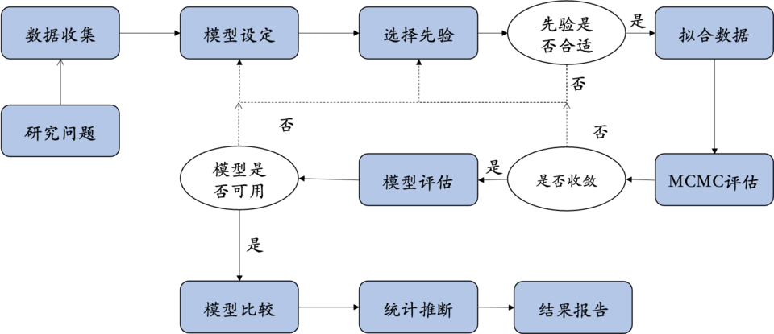{width=78% style="max-height: 520px; object-fit: contain;" fig-alt="第 11 讲原稿的贝叶斯分析流程回顾图"}

---

## 附录：反应时模型的逐一写法

下列代码把课堂矩阵模型展开为独立的 Stan 程序。模型的先验、线性预测式和生成量与课堂示例对应。每个模型的两段 Stan 代码按顺序接在一起。

## 反应时模型 1：数据、参数与似然

~~~stan
data {
  int<lower=0> N;            // 数据点数量
  vector[N] y;               // 观测数据
  vector[N] X1;              // Friend
  vector[N] X2;              // Stranger
}

parameters {
  real beta_0;                   // 截距
  real beta_1;                   // Friend 的斜率
  real beta_2;                   // Stranger 的斜率
  real<lower=0> sigma;           // 误差标准差
}

model {
  beta_0 ~ normal(5, 2);         // 截距的先验分布
  beta_1 ~ normal(0, 1);         // Friend 的斜率的先验分布
  beta_2 ~ normal(0, 1);         // Stranger 的斜率的先验分布
  sigma ~ exponential(0.3);      // 误差标准差的先验分布
  // 似然函数
  for (n in 1:N) {
    y[n] ~ normal(beta_0 + beta_1 * X1[n] + beta_2 * X2[n], sigma);
  }
}
~~~

---

## 反应时模型 1：后验预测和逐点对数似然

~~~stan
generated quantities {
  vector[N] y_rep;             // 后验预测
  vector[N] log_lik;         // 逐点对数似然

  for (n in 1:N) {
    // 后验预测值
    y_rep[n] = normal_rng(beta_0 + beta_1 * X1[n] + beta_2 * X2[n], sigma);
    // 逐点对数似然
    log_lik[n] = normal_lpdf(y[n] | beta_0 + beta_1 * X1[n] + beta_2 * X2[n], sigma);
  }
}
~~~

---

## 反应时模型 1：R 数据列表

~~~r
X1 <- as.integer(rt$Label == "Friend")
X2 <- as.integer(rt$Label == "Stranger")
Matching <- as.integer(rt$Matching == "Nonmatching")
data_list1 <- list(N = nrow(rt), y = rt$RT_sec, X1 = X1, X2 = X2)
~~~

---

## 反应时模型 2：数据、参数与似然

~~~stan
data {
  int<lower=0> N;             // 样本数量
  vector[N] y;                // 响应变量
  vector[N] X1;               // 哑变量1（Friend）
  vector[N] X2;               // 哑变量2（Stranger）
  vector[N] Matching;         // 哑变量（Matching条件）
}

parameters {
  real beta_0;                // 截距
  real beta_1;                // Friend的主效应
  real beta_2;                // Stranger的主效应
  real beta_3;                // Matching的主效应
  real<lower=0> sigma;        // 误差项的标准差
}

model {
  // 先验分布
  beta_0 ~ normal(5, 2);
  beta_1 ~ normal(0, 1);
  beta_2 ~ normal(0, 1);
  beta_3 ~ normal(0, 1);
  sigma ~ exponential(0.3);

  // 似然函数
  for (n in 1:N) {
    y[n] ~ normal(beta_0 + beta_1 * X1[n] + beta_2 * X2[n] + beta_3 * Matching[n], sigma);
  }
}
~~~

---

## 反应时模型 2：后验预测和逐点对数似然

~~~stan
generated quantities {
  vector[N] y_rep;              // 后验预测值
  vector[N] log_lik;          // 逐点对数似然

  for (n in 1:N) {
    // 后验预测值
    y_rep[n] = normal_rng(beta_0 + beta_1 * X1[n] + beta_2 * X2[n] + beta_3 * Matching[n], sigma);
    // 逐点对数似然
    log_lik[n] = normal_lpdf(y[n] | beta_0 + beta_1 * X1[n] + beta_2 * X2[n] + beta_3 * Matching[n], sigma);
  }
}
~~~

## 反应时模型 2：R 数据列表

~~~r
data_list2 <- c(data_list1, list(Matching = Matching))
~~~

---

## 反应时模型 3：数据、参数与似然

~~~stan
data {
  int<lower=0> N;                 // 样本数量
  vector[N] y;                    // 响应变量
  vector[N] X1;                   // 哑变量1（Friend）
  vector[N] X2;                   // 哑变量2（Stranger）
  vector[N] Matching;             // 哑变量（Matching条件）
  vector[N] Interaction_1;        // Friend 和 Matching 的交互
  vector[N] Interaction_2;        // Stranger 和 Matching 的交互
}

parameters {
  real beta_0;                    // 截距
  real beta_1;                    // Friend的主效应
  real beta_2;                    // Stranger的主效应
  real beta_3;                    // Matching的主效应
  real beta_4;                    // Friend与Matching的交互效应
  real beta_5;                    // Stranger与Matching的交互效应
  real<lower=0> sigma;            // 误差项的标准差
}

model {
  // 先验分布
  beta_0 ~ normal(5, 2);
  beta_1 ~ normal(0, 1);
  beta_2 ~ normal(0, 1);
  beta_3 ~ normal(0, 1);
  beta_4 ~ normal(0, 1);
  beta_5 ~ normal(0, 1);
  sigma ~ exponential(0.3);

  // 似然函数
  for (n in 1:N) {
    y[n] ~ normal(beta_0 + beta_1 * X1[n] + beta_2 * X2[n] + beta_3 * Matching[n] + beta_4 * Interaction_1[n] + beta_5 * Interaction_2[n], sigma);
  }
}
~~~

---

## 反应时模型 3：后验预测和逐点对数似然

~~~stan
generated quantities {
  vector[N] y_rep;                  // 后验预测值
  vector[N] log_lik;              // 逐点对数似然

  for (n in 1:N) {
    // 后验预测值（原有）
    y_rep[n] = normal_rng(beta_0 + beta_1 * X1[n] + beta_2 * X2[n] + beta_3 * Matching[n] +
                          beta_4 * Interaction_1[n] + beta_5 * Interaction_2[n], sigma);
    // 逐点对数似然（原有）
    log_lik[n] = normal_lpdf(y[n] | beta_0 + beta_1 * X1[n] + beta_2 * X2[n] + beta_3 * Matching[n] +
                            beta_4 * Interaction_1[n] + beta_5 * Interaction_2[n], sigma);
  }
}
~~~

## 反应时模型 3：R 数据列表

~~~r
data_list3 <- c(data_list2, list(Interaction_1 = X1 * Matching,
                                Interaction_2 = X2 * Matching))
~~~
