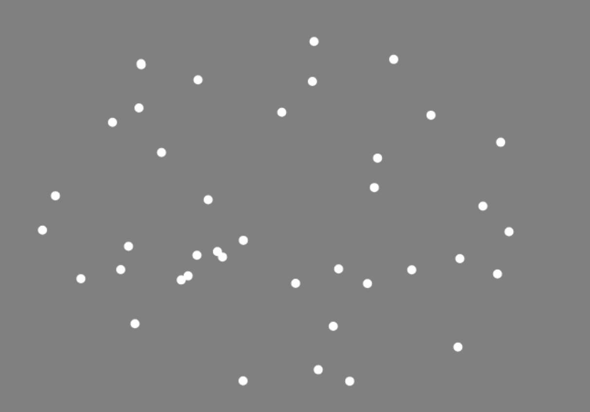
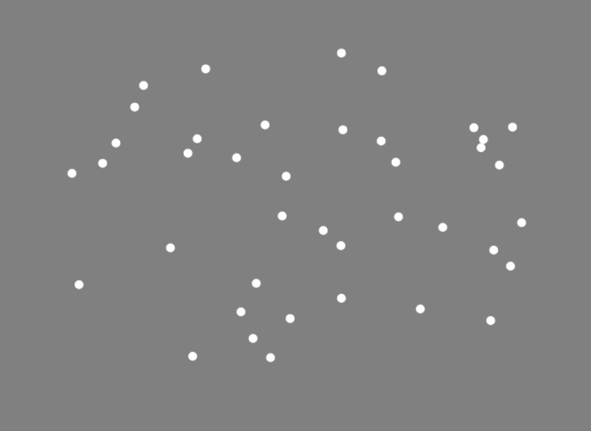

```{r}
#| include: false
knitr::opts_chunk$set(fig.path = "assets/figs/lec3/")
set.seed(84735)
theme_set <- function() {
  par(
    mar = c(4.2, 4.4, 2.2, 1.2),
    cex.axis = 1.15,
    cex.lab = 1.25,
    cex.main = 1.25
  )
}
fixme <- function(text) {
  paste0("<span style='color:#c1121f; font-weight:700;'>", text, "</span>")
}
```

## 回顾：第2讲的两个例子与贝叶斯公式的四个成分

::: {style="font-size:0.82em;"}
**前提**：两个例子的参数 $\theta$ 都只取少数几个**离散**值
:::

- 例1：$\theta \in \{0,\ 0.25,\ 0.5,\ 0.75,\ 1\}$；
- 例2：$\theta \in \{0.2,\ 0.5,\ 0.8\}$

| 成分 | 例1：蓝色小球计数（数据 = “蓝白蓝”） | 例2：复现成功率（数据 = 6 项中成功 1 项） |
|---|---|---|
| **先验** prior $P(\theta)$ | 5 种推测等可能，各 **0.2** | **0.10 / 0.25 / 0.65** |
| **似然** likelihood $P(D \mid \theta)$ | ways = **0 / 3 / 8 / 9 / 0** | **0.3932 / 0.0938 / 0.0015** |
| **归一化因子** $P(D)$ | $0\times.2+3\times.2+8\times.2+9\times.2+0\times.2 =$ **4.0** | $0.10\times.3932+0.25\times.0938+0.65\times.0015 \approx$ **0.0637** |
| **后验** posterior $P(\theta \mid D)$ | **0 / 0.15 / 0.40 / 0.45 / 0** | **0.617 / 0.368 / 0.015** |

$P(\theta \mid D) = \frac{P(D\mid \theta)P(\theta)}{P(D)}$ 

本讲把离散的 $\theta$ 换成连续的 $\theta$ (正确率)。

## 学习目标

学习完本课，应该可以：

- 用 **Beta 分布**表达对取值范围在 $[0,1]$ 间的 $\theta$ 的先验信念
- 用 **Binomial 分布**描述从 $\theta$ 到数据 “正确/错误” 二分数据的关系
- 解释 **likelihood** 如何比较不同 $\theta$  与观测数据的兼容性
- 理解 Beta-Binomial 模型的后验更新公式
- 用模拟理解“后验分布”从哪里来

## Outlines

- **1. 研究问题** — 随机点运动任务中的正确率
- **2. 理论模型** — Beta 先验与 Binomial 数据模型
- **3. 贝叶斯更新** — 似然函数与后验分布
- **4. 模拟理解** — 用模拟近似后验
- **5. 总结练习** — 四个建模要素与迁移练习

## Part 1: 从正确率到参数

随机点运动任务 (Random dot motion task) 用于研究感知决策。

被试需要判断随机点阵的整体运动方向；点的一致性越高，方向信息越清楚，任务通常越容易。

:::: {.columns}

::: {.column width="50%"}
<center>


一致性 10%
</center>
:::

::: {.column width="50%"}
<center>


一致性 60%
</center>
:::

::::

## 正确率不是终点

一次实验后，我们可以得到一个观察到的正确率（多个试次中正确试次的百分比）。

但贝叶斯建模关心的是：

$$
\text{观察到的正确次数 } Y
\quad \Rightarrow \quad
\text{潜在正确能力 } \theta
$$

$\theta$ 不是直接观察到的值，而是我们要推断的参数。

## 为什么需要不确定性？

假设 50 次试验中有 30 次正确。

$$
\hat{\theta} = \frac{30}{50} = 0.60
$$

这个数很有用，但它没有回答：

- 真正的 $\theta$ 可能是 0.55 吗？
- 可能是 0.70 吗？
- 我们对这些可能性有多确定？

## 先验从哪里来？

在看到当前数据前，我们可能已经知道：

- 5% 一致性条件下任务不容易
- 先前研究中个体正确率约在 0.70 附近
- $\theta$ 必须位于 $[0,1]$

因此，我们需要一个定义在 $[0,1]$ 上的先验模型。

## 离散先验的直觉

:::: {.columns}

::: {.column width="52%"}

```{r}
#| fig-width: 7.2
#| fig-height: 4.2
theme_set()
theta_disc <- seq(0.1, 1.0, by = 0.1)
prior_prob <- c(0, 0, 0, 0, 0, 0.1, 0.8, 0.1, 0, 0)
barplot(
  prior_prob,
  names.arg = theta_disc,
  col = "skyblue",
  border = "white",
  xlab = expression(theta),
  ylab = "Prior probability",
  main = "Discrete prior"
)
```
:::

::: {.column width="48%"}
::: {style="font-size:0.78em; line-height:1.18;"}
第2讲两个例子的先验都是“**有限个取值 + 各自概率，和为 1**”。

但 $\theta$ 可以是 $[0,1]$ 中任意值：只允许 0.6、0.7、0.8 就过于粗糙；把取值网格**不断加密**，离散先验的极限就是一条连续曲线。

$$
f(\theta), \quad 0 \le \theta \le 1
$$

它同样要满足“总面积 = 1”，只是把求和换成积分：

$$
\int_0^1 f(\theta)\,d\theta = 1
$$
:::
:::

::::

## 从第2讲到本讲：四成分不变，取值从离散到连续

| 环节 | 上一课（离散） | 本讲（连续） |
|---|---|---|
| 数据模型 | $\text{Bin}(6, \theta)$ | $\text{Bin}(50, \theta)$ |
| 参数 | $\theta \in \{0.2,\ 0.5,\ 0.8\}$（或 5 种蓝球占比） | $\theta \in [0, 1]$ |
| 先验 | 表格：有限个取值，概率**和为 1** | $\text{Beta}(70, 30)$：曲线，**积分为 1** |
| 似然 | 只在 3 个点上计算 | 在 $[0,1]$ 上**处处**可计算 |
| 归一化因子 | 求和 $\sum f(\theta)L(\theta \mid y)$ | 积分 $\int_0^1 f(\theta)L(\theta \mid y)\,d\theta$ |
| 后验 | 三个点的概率 | $\text{Beta}(100, 50)$（共轭直接计算） |

> 变的只是“取值个数：有限 → 无限”；先验、似然、证据、后验的**含义与用法完全不变**。

## Part 2: Beta 先验

Beta 分布非常适合表示 $[0,1]$ 上的概率参数。

$$
\theta \sim \text{Beta}(\alpha, \beta)
$$

其中：

- $\alpha > 0, \beta > 0$
- 参数控制分布形状
- 可以表达“偏低”“偏高”“集中”“分散”等先验信念

## Beta 分布的形状

```{r}
#| fig-width: 11
#| fig-height: 6.4
theme_set()
local({
  x <- seq(0, 1, length.out = 1000)
  params <- list(c(1, 5), c(1, 2), c(3, 7),
                 c(1, 1), c(5, 5), c(20, 20),
                 c(7, 3), c(2, 1), c(5, 1))
  op <- par(mfrow = c(3, 3), mar = c(3.1, 3.2, 2.1, 0.8))
  on.exit(par(op))
  for (p in params) {
    y <- dbeta(x, p[1], p[2])
    plot(
      x, y, type = "l", lwd = 2, col = "cyan4",
      xlab = expression(theta), ylab = "Density",
      main = paste0("Beta(", p[1], ", ", p[2], ")")
    )
  }
})
```

## 先验

我们首先设定一下直觉上合理的先验：

$$
\theta \sim \text{Beta}(70, 30)
$$

其均值为：

$$
E(\theta) = \frac{70}{70 + 30} = 0.70
$$

当前数据出现前，我们认为 $\theta$ 大约在 0.70 附近。

直观上，$\alpha$ 越大越偏向 1，$\beta$ 越大越偏向 0，$\alpha+\beta$ 越大分布越集中。

## 连续先验图

```{r}
#| fig-width: 8.8
#| fig-height: 5
theme_set()
x <- seq(0, 1, length.out = 1000)
plot(
  x, dbeta(x, 70, 30),
  type = "l", lwd = 3, col = "cyan4",
  xlab = expression(theta), ylab = "Density",
  main = "Prior: Beta(70, 30)"
)
abline(v = 0.70, lty = 2, col = "red", lwd = 2)
text(0.72, max(dbeta(x, 70, 30)) * 0.85, "Mean = 0.70", col = "red", adj = 0)
```

## Part 3: Binomial 与似然

现在收集 50 次随机点运动任务数据。每次试验只有两个结果：正确 `1` 或错误 `0`。

记正确次数为 `Y`，总试次数为 `n = 50`。

如果每次试验正确概率都是 $\theta$，并且试验相互独立：

$$
Y | \theta \sim \text{Bin}(50, \theta)
$$

概率质量函数为：

$$
P(Y = y | \theta) = \binom{50}{y}\theta^y(1-\theta)^{50-y}
$$

## 不同 $\theta$ 产生不同 Y

```{r}
#| fig-width: 11
#| fig-height: 6.2
theme_set()
local({
  y <- 0:50
  p_values <- seq(0.1, 0.9, by = 0.1)
  ticks <- c(0, 10, 20, 30, 40, 50)   # X 轴显示的刻度
  op <- par(mfrow = c(3, 3), mar = c(3.0, 3.0, 2.0, 0.8))
  on.exit(par(op))
  for (p in p_values) {
    prob <- dbinom(y, size = 50, prob = p)
    bp <- barplot(
      prob,
      names.arg = rep("", length(y)),  # 栏内不写字，交给下面的 axis()
      xaxt = "n",                      # 关掉默认坐标轴
      col = "grey75", border = NA,
      ylim = c(0, 0.20),
      xlab = "", ylab = "",
      main = paste0("Bin(50, ", p, ")")
    )
    axis(1, at = as.numeric(bp)[y %in% ticks], labels = ticks)
  }
})
```

## 观察到的数据

教材案例聚焦于：

$$
n = 50, \quad y = 30
$$

也就是 50 次试验中有 30 次正确。

问题变成：

> 哪些 $\theta$ 更容易生成 `Y = 30` 这样的数据？

## 从数据到似然

对于任意一个候选 $\theta$，都可以计算：

$$
P(Y=30 | \theta)
$$

当我们把 `Y=30` 固定，把 $\theta$ 当作横轴变化时，就得到似然函数：

$$
L(\theta | Y=30) = \binom{50}{30}\theta^{30}(1-\theta)^{20}
$$

## 似然函数

```{r}
#| fig-width: 9
#| fig-height: 5
theme_set()
theta <- seq(0, 1, length.out = 1000)
lik <- dbinom(30, size = 50, prob = theta)
plot(
  theta, lik,
  type = "l", lwd = 3, col = "grey35",
  xlab = expression(theta), ylab = "Likelihood",
  main = "Likelihood: L(θ | Y = 30)"
)
abline(v = 0.60, lty = 2, col = "red", lwd = 2)
text(0.62, max(lik) * 0.85, "Maximum near θ = 0.60", col = "red", adj = 0)
```

## 似然不是后验

似然回答的是：

> 如果 $\theta$ 是某个值，观察到 `Y=30` 有多可能？

它还没有回答：

> 看到 `Y=30` 后，$\theta$ 的后验分布是什么？

要回答第二个问题，需要合并先验和似然。

> 📌 这正是第2讲“**后验 ∝ 先验 × 似然**（省略分母）”那条性质：那里是**求和**，这里是**积分**。而 Beta-Binomial 的好处是——连积分都不必做（共轭，见后）。

## Part 4: 后验模型

正确率的二项分布模型可以完整地写为：

$$
\begin{aligned}
Y | \theta &\sim \text{Bin}(50, \theta) \\
\theta &\sim \text{Beta}(70, 30)
\end{aligned}
$$

贝叶斯更新的核心：

$$ 
f(\theta | Y=30) \propto f(\theta)L(\theta | Y=30)
$$

似然只看数据；后验同时结合先验和数据。

## 先验、似然与课堂判断

```{r}
#| fig-width: 9.4
#| fig-height: 5.2
theme_set()
theta <- seq(0, 1, length.out = 1000)
prior <- dbeta(theta, 70, 30)
lik <- dbinom(30, 50, theta)
lik_scaled <- lik / max(lik) * max(prior)
plot(
  theta, prior,
  type = "l", lwd = 3, col = "#f0b400",
  xlab = expression(theta), ylab = "Scaled density",
  main = "Prior and likelihood",
  ylim = c(0, max(prior) * 1.05)
)
lines(theta, lik_scaled, lwd = 3, col = "#0071b2")
legend(
  "topright",
  legend = c("Prior: center near 0.70", "Likelihood: peak near 0.60"),
  col = c("#f0b400", "#0071b2"),
  lwd = 3,
  bty = "n"
)
```

后验应该位于二者之间，并且比先验更集中。

## 后验分布

```{r}
#| fig-width: 10.5
#| fig-height: 5.4
theme_set()
theta <- seq(0, 1, length.out = 2000)
prior <- dbeta(theta, 70, 30)
lik <- dbinom(30, 50, theta)
lik_scaled <- lik / max(lik) * max(prior)
posterior <- dbeta(theta, 100, 50)
plot(
  theta, prior,
  type = "l", lwd = 3, col = "#f0b400",
  xlab = expression(theta), ylab = "Density / scaled likelihood",
  main = "Prior, likelihood, and posterior",
  ylim = c(0, max(posterior) * 1.1)
)
lines(theta, lik_scaled, lwd = 3, col = "#0071b2")
lines(theta, posterior, lwd = 3, col = "#009e74")
legend(
  "topright",
  legend = c("Prior", "Likelihood (scaled)", "Posterior"),
  col = c("#f0b400", "#0071b2", "#009e74"),
  lwd = 3,
  bty = "n"
)
```

## 共轭分布

Beta-Binomial 模型有一个简单的后验结果：

$$
\theta | (Y=y) \sim \text{Beta}(\alpha + y, \beta + n - y)
$$

带入这里的数值：

$$
\theta | (Y=30) \sim \text{Beta}(70+30, 30+20)
$$

$$
\theta | (Y=30) \sim \text{Beta}(100, 50)
$$

这也是 Beta 作为 Binomial 共轭先验带来的计算便利。

## 参数如何更新？

:::: {.columns}

::: {.column width="50%"}
先验：

$$
\theta \sim \text{Beta}(70, 30)
$$

数据：

$$
y = 30, \quad n-y = 20
$$
:::

::: {.column width="50%"}
后验：

$$
\alpha_{\text{post}} = 70 + 30 = 100
$$

$$
\beta_{\text{post}} = 30 + 20 = 50
$$
:::

::::

## 更新前后比较

| 指标 | Prior: Beta(70,30) | Posterior: Beta(100,50) |
|---|---:|---:|
| $\alpha$ | 70 | 100 |
| $\beta$ | 30 | 50 |
| mean | 0.700 | 0.667 |
| mode | 0.704 | 0.668 |
| sd | 0.0456 | 0.0384 |

数据把中心从 0.70 拉向 0.60，同时减少了不确定性。

## Part 5: 用模拟理解后验

公式告诉我们后验是 `Beta(100,50)`。模拟帮助我们理解：

> 后验可以看作“那些能生成观察数据的参数值”的分布。

**这四步就是第2讲的 posterior simulation**——区别只在取值方式：第2讲抽的是**离散**的 $\theta$，本讲抽的是**连续**的 $\theta$：

1. 从先验中抽很多个可能的 $\theta$
2. 对每个 $\theta$ 模拟 50 次试验中的正确次数 `Y`
3. 只保留那些 `Y = 30` 的模拟样本
4. 查看保留下来的 $\theta$ 分布

## 生成模拟数据

```{r}
n_sim <- 10000
sim <- data.frame(
  theta = rbeta(n_sim, shape1 = 70, shape2 = 30)
)
sim$Y <- rbinom(n_sim, size = 50, prob = sim$theta)
head(sim)
```

## 哪些模拟样本匹配 Y = 30？

```{r}
#| fig-width: 9
#| fig-height: 5
theme_set()
matched <- sim$Y == 30
plot(
  sim$theta[!matched], sim$Y[!matched],
  pch = 16, col = rgb(0, 0, 0, 0.22), cex = 0.55,
  xlab = "Simulated θ", ylab = "Simulated Y",
  main = "Simulated θ and Y"
)
points(
  sim$theta[matched], sim$Y[matched],
  pch = 16, col = rgb(0, 0.25, 1, 0.8), cex = 0.8
)
abline(h = 30, col = "blue", lwd = 2, lty = 2)
legend(
  "topleft",
  legend = c("Y != 30", "Y = 30"),
  col = c("grey30", "blue"),
  pch = 16,
  bty = "n"
)
```

## 筛选后的 $\theta$ 近似后验

```{r}
#| fig-width: 9
#| fig-height: 5
theme_set()
posterior_sim <- sim$theta[sim$Y == 30]
hist(
  posterior_sim,
  breaks = 18,
  probability = TRUE,
  col = "lightblue",
  border = "white",
  xlab = expression(theta),
  main = "Simulated posterior: keep θ where Y = 30"
)
lines(density(posterior_sim), col = "blue", lwd = 3)
curve(dbeta(x, 100, 50), from = 0, to = 1, add = TRUE, col = "#009e74", lwd = 3)
legend(
  "topright",
  legend = c("Simulation", "Beta(100,50)"),
  col = c("blue", "#009e74"),
  lwd = 3,
  bty = "n"
)
```

## 课堂练习

沿用第2讲“心理学研究可重复性”的情境（当时 $\theta \in \{0.2, 0.5, 0.8\}$，6 项研究只成功复现 1 项），这次把它做成**连续版**：

- 假设可重复研究出现的概率为 $\theta$
- 自行选择一个 Beta 先验
- 模拟 10,000 个 $\theta$ 值
- 假设总研究数量 $n=100$，根据 $\theta$ 模拟可重复研究数量 $Y$
- 绘制先验分布和后验分布

## Summary

Beta-Binomial 模型：

$$
\begin{aligned}
Y | \theta &\sim \text{Bin}(n, \theta) \\
\theta &\sim \text{Beta}(\alpha, \beta)
\end{aligned}
$$

后验：

$$
\theta | (Y=y) \sim \text{Beta}(\alpha + y, \beta + n - y)
$$

## 四个建模要素

**前提**
数据模型 $Y \mid \theta \sim \text{Bin}(50, \theta)$ 
感兴趣的参数：$\theta$ 被试真正做对的概率

| 要素 | 本例对应 |
|---|---|
| 先验 | $\theta \sim \text{Beta}(70, 30)$ |
| 似然 | $L(\theta \mid Y=30)$ |
| 归一化因子 | 所有 $L(\theta \mid Y=30)$ 的和 |
| 后验 | $\theta \mid Y=30 \sim \text{Beta}(100, 50)$ |

> 与第2讲那张四成分表**一一对应**，只是 $\theta$ 从离散取值变成了连续取值。

## 贝叶斯框架下的 $\theta$

正确率不再是一个描述统计值

它是一个概率分布，可以被更新：

$$
\text{先验信念} + \text{数据证据}
\Rightarrow
\text{更新后的不确定性}
$$

在本课中，我们使用一个完整的统计模型 —— Beta-Binomial —— 对这一过程进行表示。

## References

- Evans, N. J., Hawkins, G. E., & Brown, S. D. (2020). The role of passing time in decision-making. *Journal of Experimental Psychology: Learning, Memory, and Cognition, 46*(2), 316-326.
- Shooshtari, S. V., Sadrabadi, J. E., Azizi, Z., & Ebrahimpour, R. (2019). Confidence representation of perceptual decision by EEG and eye data in a random dot motion task. *Neuroscience, 406*, 510-527.
