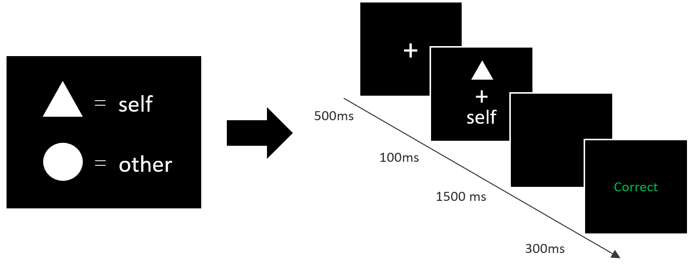
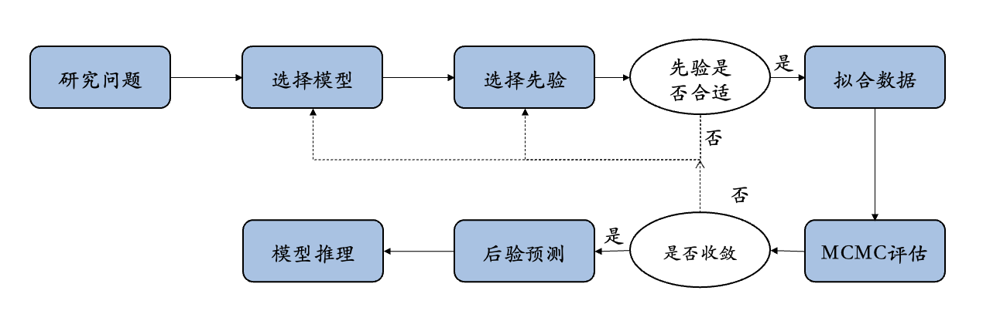
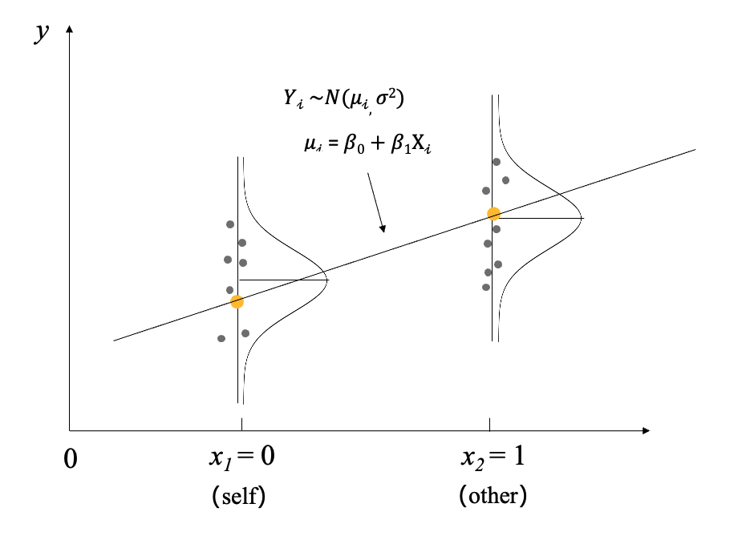
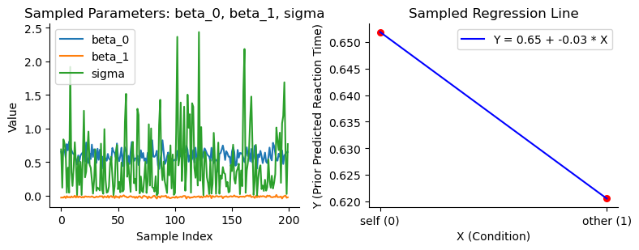
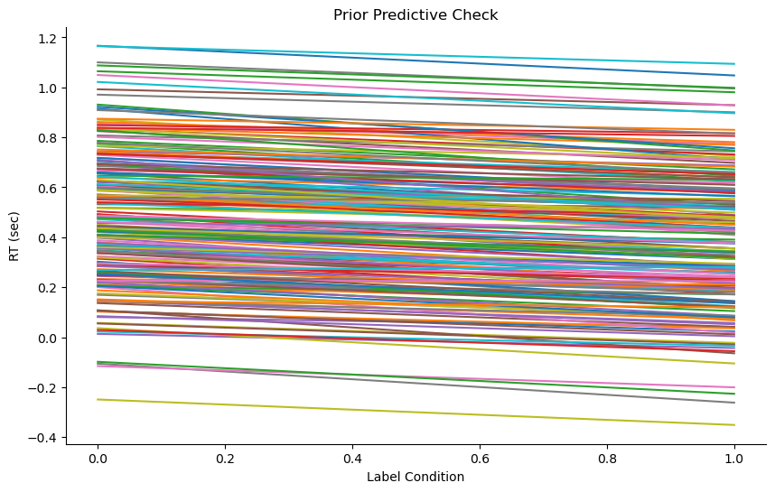

```{r}
#| label: setup
#| include: false
knitr::opts_chunk$set(fig.path = "assets/figs/lec9/", fig.width = 12, fig.height = 5, dpi = 144)
```

---

## 序言

> ⭐ 先前的课程中，基于最简单的beta-binomial模型，我们学习了贝叶斯方法的全部基础。
>
> 但并没有使用贝叶斯模型深入到真正的心理学研究当中。
>
> 本节课开始，将通过一个个真实的案例，将贝叶斯统计用于心理学研究。

---

## 研究示例： 自我加工优势 (Self-prioritization Effect, SPE)

在本节课，以下如下问题作为一个开始： "自我作为人类独特的心理概念，是否会促进认知加工的表现？"

具体而言，我们通过知觉匹配任务来探索一下：**自我和他人条件下，人们在知觉匹配任务上的表现是否有差异，尤其是在反应时间上的表现。**

> 探究自我加工的优势通畅使用匹配范式任务中"自我（self）"和"他人（other）"的认知匹配之间的关系 (Sui et al., 2012)。
>
> - 在自我匹配任务中，被试首先学习几何图形和身份标签的关系。例如，三角形代表自我；圆形代表他人。在随后的知觉匹配判断任务中，需要判断所呈现的几何图形和文字标签是否与之前学习的关系相匹配。
>
> - 想象一下你在完成自我匹配任务时，面对不同的刺激：有时你可能会觉得某个"自我"相关的图像比"他人"相关的更具吸引力，或许这反映了你对自己本身具有更多的关注。

---



> Sui, J., He, X., & Humphreys, G. W. (2012). Perceptual effects of social salience: Evidence from self-prioritization effects on perceptual matching. Journal of Experimental Psychology: Human Perception and Performance, 38(5), 1105--1117. [https://doi.org/10.1037/a0029792](https://doi.org/10.1037/a0029792){target="_blank" rel="noopener noreferrer nofollow"}

---

Sui et al., (2012)已经发现，**与在"他人"条件相比，个体"自我"条件下完成知觉匹配的反应时间更快。**

在贝叶斯的框架下，应该如何建立模型并检验该研究假设？



---

我们将通过这个例子，学习如何完成贝叶斯的简单线性模型 (linear regression model) ，其包括如下内容：

1.  **完成简单线性模型的建构**。

2.  **检验先验是否合理：先验预测检验**。

3.  对模型进行拟合并诊断结果是否可靠。

4.  基于后验进行推断。

5.  **模型检验 (后验预测检验)**。

---

数据来自于Kolvoort等(2020)，该数据集包含了多个被试在自我匹配任务下的行为数据，这些被试有着不同年龄、性别、文化背景。

- 我们使用 `read.csv` 方法读取项目 `data/` 目录中的 `Kolvoort_2020_HBM_Exp1_Clean.csv`。

- 数据包含多个变量，选择我们需要的`Label` 表示标签（self / other），`RT_sec` 表示被试的反应时间。

- 每一行(index)表示一个trial数。

> - 数据来源: Kolvoort, I. R., Wainio‐Theberge, S., Wolff, A., & Northoff, G. (2020). Temporal integration as "common currency" of brain and self‐scale‐free activity in resting‐state EEG correlates with temporal delay effects on self‐relatedness. Human brain mapping, 41(15), 4355-4374.

---

先加载本讲需要的 R 包。

```{r}
# 导入所需库
options(repos = c(CRAN = "https://mirrors.tuna.tsinghua.edu.cn/CRAN/"))
if (!requireNamespace('pacman', quietly = TRUE)) {
    install.packages('pacman')
}
pacman::p_load("tidyverse","ggplot2", "dplyr","gridExtra","papaja", "patchwork","bayesplot","rstan","brms")
```

---

读取实验数据，并查看原始记录的前几行。

```{r}
# 加载数据
df_raw <- utils::read.csv(file.path("data", "Kolvoort_2020_HBM_Exp1_Clean.csv"))

# 显示数据前几行
head(df_raw)
```

---

筛选被试 201 的匹配试次，并统一标签编码。

```{r}
# 筛选出被试"201"，匹配类型为"Matching"的数据
df_raw$Subject <- as.character(df_raw$Subject)
df <- df_raw %>%
  dplyr::filter(Subject == "201" & Matching == "Matching") %>%
  # 选择需要的两列
  dplyr::select(Label, RT_sec) %>%
  # 重新编码标签（Label）
  dplyr::mutate(Label = case_when(
    Label == 1 ~ 0,
    Label == 2 ~ 1,
    Label == 3 ~ 1
  )) %>%
  # 设置索引
  dplyr::mutate(index = row_number()) %>%
  column_to_rownames("index")

# 显示处理后的数据前几行
head(df)
```

---

进一步可视化数据情况

- 我们使用 `gglot` 方法来进行可视化。

- 其中横轴为Label `x="Label"`，纵轴为反应时间 `y="RT_sec"`。

---

比较两种标签条件下的反应时分布与均值。

```{r}
# 计算每个Label条件下的均值
mean_values <- df %>%
  dplyr::group_by(Label) %>%
  dplyr::summarise(mean_RT = mean(RT_sec), .groups = "drop")

# 绘制符合APA格式的箱线图
ggplot2::ggplot(df, aes(x = factor(Label), y = RT_sec)) +
  ggplot2::geom_boxplot() +
  ggplot2::geom_line(data = mean_values, aes(x = factor(Label), y = mean_RT, group = 1), 
            color = "red", linewidth = 1) +
  ggplot2::geom_point(data = mean_values, aes(x = factor(Label), y = mean_RT), 
             color = "red", size = 3) +
  # 使用APA格式主题
  papaja::theme_apa() +
  # 添加标签（APA格式通常要求清晰简洁的标签）
  labs(x = "Label Condition (0 = self, 1 = other)",
       y = "Reaction Time (sec)")
```

---

## 简单线性回归：使用线性模型表示两种条件下反应的差异

### 频率学派视角下的回归模型

简单回顾: 在传统频率学派的视角下，回归模型的建立和检验一般基于参数估计和假设检验：

1.  **构建模型**：简单线性回归模型，反应时间（RT_sec）作为因变量，自变量为二分离散变量（Label）。我们可以将 `self` 编码为 0，`other` 编码为 1，这样模型将估计出"他人"条件相较于"自我"条件在反应时间上的效应。

模型形式为：

$$ RT_{sec} = \beta_0 + \beta_1 \cdot Label + \epsilon $$

其中，$\beta_0$表示"self"条件下的平均反应时间，$\beta_1$表示other条件下相较于self条件的反应时间差异。

---

2.  **假设检验**：在该模型中，$\beta_1$的显著性可以用 *t* 检验来判断。如果$\beta_1$显著不为 0（例如$p < 0.05$），则说明他人条件下的反应时间显著不同于自我条件，即可能存在自我加工的优势。

3.  **模型解释**：若$\beta_1$为正值，则表明自我条件的反应时间较短，暗示自我加工速度较快。

---

### 贝叶斯视角下的回归模型

在贝叶斯视角下，回归模型的参数并不是某个固定的"真值"，而是一个概率分布。因此，贝叶斯模型下的回归模型是要根据数据对模型的参数进行更新。

1.  **构建贝叶斯模型**：确定模型及其参数$\beta_0$和$\beta_1$，并形成贝叶斯模型的三个部分：似然函数、先验分布与数据：

$$ RT_{sec} \sim \mathcal{N}(\beta_0 + \beta_1 \cdot Label, \sigma^2) $$

$$ \beta_1 \sim \mathcal{N}(\mu_1, \sigma_1^2) $$

$$ \beta_0 \sim \mathcal{N}(\mu_0, \sigma_0^2) $$

$$ Data $$

---

2.  **获得后验分布**：使用贝叶斯推断方法（如 MCMC 采样）得到$\beta_1$（和$\beta_0$） 的后验分布。

3.  **模型诊断**：诊断后验分布的近似结果是否可信。

4.  **统计推断**：通过后验分布检验$\beta_1$，例如计算$\beta_1 > 0$或$\beta_1 < 0$的概率，或计算最高密度区间（HDI）。如果 95% HDI 不包含 0，可以认为自我条件和他人条件在反应时间上的差异是显著的。

5.  **结果解释**：在贝叶斯框架下，不仅可以观察参数的点估计（如$\beta_1$的均值），还可以通过后验分布和 HDI 提供更加直观的置信水平解释。

---

**⭐回归模型的可视化表达**

- 预测值$\mu_i$(即直线上橙色的点)可以写为：$\mu_i = \beta_0 + \beta_1 X_i(1)$

- 从图上可以看到预测值和实际值 (即灰色的散点)之间存在出入，实际值会在预测值附近波动。那么实际值可以看作服从以$\mu_i$为均值，标准差为$\sigma$的正态分布，即：$Y_i \sim N(\mu_i, \sigma ^ 2)$



*(改编自：https: // saylordotorg.github.io/text_introductory-statistics/s14-03-modelling-linear-relationships.html)*

---

**贝叶斯回归模型的数学表达式**

$$ \begin{align*} \beta_0 &\sim N\left(\mu_0, \sigma_0^2 \right) \\ \beta_1 &\sim N\left(\mu_1, \sigma_1^2 \right) \\ \sigma &\sim \text{Exp}(\lambda) \\ &\Downarrow \\ \mu_i &= \beta_0 + \beta_1 X_i + \sigma \\ &\Downarrow \\ Y_i | \beta_0, \beta_1, \sigma &\stackrel{ind}{\sim} N\left(\mu_i, \sigma^2\right). \\ \end{align*} $$

---

- 回归模型需满足如下假设：

  1.  独立观测假设:每个观测值$Y_i$是相互独立的，即一个被试的反应时间不受其他被试的影响。

  2.  线性关系假设: 预测值$\mu_i$和自变量$X_i$之间可以用线性关系来描述，即：$\mu_i = \beta_0 + \beta_1 X_i$

  3.  方差同质性假设： 在任意自变量的取值下，观测值$Y_i$都会以$\mu_i$为中心，同样的标准差$\sigma$呈正态分布变化（$\sigma$is consistent）

---

## 定义先验

在贝叶斯的分析框架中，我们需要为模型中的每个参数设置先验分布。

而根据之前的模型公式(数据模型)可发现，我们的$Y$为被试反应时间(RT_sec)，$X$为标签（Label），并且存在三个未知的参数$\beta_0, \beta_1, \sigma$。

因此，我们需要对每个未知的参数定义先验分布。

$$
\begin{aligned}
\beta_0 &\sim N\left(m_0, s_0^2\right) \\
\beta_1 &\sim N\left(m_1, s_1^2\right) \\
\sigma &\sim \mathrm{Exp}(\lambda)
\end{aligned}
$$

---

> - 参数的前提假设(assumptions):
>
>   -$\beta_0, \beta_1, \sigma$之间相互独立
>
> - 此外，规定$\sigma$服从指数分布，以限定其值恒为正数
>
> - 其中，$\mu_0, \sigma_0, \mu_1, \sigma_1$为超参数
>
>   - 我们需要根据我们对$\beta_0$和$\beta_1$的先验理解来选择超参数的范围
>
>   - 比如，$\beta_1$反映了标签从 self 切换到 other 时，反应时间的平均变化值；$\beta_0$反映了在 other 条件下的基础反应时间

---

## 定义先验

$$
\begin{aligned}
Y_i \mid \beta_0, \beta_1, \sigma
  &\stackrel{\mathrm{ind}}{\sim} N\left(\mu_i, \sigma^2\right),
  \qquad \mu_i = \beta_0 + \beta_1 X_i \\
\beta_0 &\sim N\left(5, 2^2\right) \\
\beta_1 &\sim N\left(0, 1^2\right) \\
\sigma &\sim \operatorname{Exp}(0.3)
\end{aligned}
$$

这里，根据经验或直觉对先验(超参, hyper-parameter)进行定义：

- 其次，我们假设$\beta_0$服从均值为 5，标准差为 2 的正态分布,代表：

  - 当实验条件为 self（编码为 0）时，反应时间的平均值大约为 5 秒。

  - 截距值可能在 3 ± 7 秒 的范围内波动，反映了在 self 条件下的反应时间预估

---

- 我们假设$\beta_1$服从均值为 0，标准差为 1 的正态分布，代表：

  - (斜率)将其均值指定为 1，表示我们预期在 self 和 other 条件下的反应时间差异较小。

    - 这个影响的量是变化的，范围大概在 -1 ± 1。

- 最后，我们假设$\sigma$服从指数分布，其参数为0.3。

  - 参数0.3 意味着标准差通常集中在较小的正数范围内，使反应时间在预测值$\mu_i$附近波动。

  - 这一设置允许较小到中等的波动，但大部分数据应集中在 0 到 10 秒的合理反应时间范围内。

---

**先验的可视化**

```{r}
# 定义先验分布的参数
mu_beta0 <- 5         
sigma_beta0 <- 2     
mu_beta1 <- 0       
sigma_beta1 <- 1   
lambda_sigma <- 0.3      

# 生成 beta_0 的先验分布数据
x_beta0 <- seq(-5, 15, length.out = 1000)
y_beta0 <- dnorm(x_beta0, mean = mu_beta0, sd = sigma_beta0)
df_beta0 <- data.frame(x = x_beta0, y = y_beta0)

# 生成 beta_1 的先验分布数据
x_beta1 <- seq(-5, 5, length.out = 1000)
y_beta1 <- dnorm(x_beta1, mean = mu_beta1, sd = sigma_beta1)
df_beta1 <- data.frame(x = x_beta1, y = y_beta1)

# 生成 sigma 的先验分布数据（指数分布）
x_sigma <- seq(0, 10, length.out = 1000)
y_sigma <- dexp(x_sigma, rate = lambda_sigma)  # R中指数分布参数为rate=λ
df_sigma <- data.frame(x = x_sigma, y = y_sigma)

# 自定义despine函数（作为ggplot图层使用，无需传递参数）
despine <- function() {
  ggplot2::theme(
    panel.border = element_blank(),
    axis.line = element_line(color = "black"),
    panel.grid.minor = element_blank(),
    panel.grid.major.x = element_blank(),
    panel.grid.major.y = element_blank(),
    axis.ticks = element_line(color = "black")
  )
}

# 绘制 beta_0 的先验分布
p1 <- ggplot2::ggplot(df_beta0, aes(x = x, y = y)) +
  ggplot2::geom_line(color = "black") +
  ggplot2::ggtitle(expression(N(5, 2^2))) +
  ggplot2::xlab(expression(beta[0])) +
  ggplot2::ylab("pdf") +
  papaja::theme_apa() +
  despine()  # 作为图层直接添加

# 绘制 beta_1 的先验分布
p2 <- ggplot2::ggplot(df_beta1, aes(x = x, y = y)) +
  ggplot2::geom_line(color = "black") +
  ggplot2::ggtitle(expression(N(0, 1^2))) +
  ggplot2::xlab(expression(beta[1])) +
  ggplot2::ylab("pdf") +
  papaja::theme_apa() +
  despine()

# 绘制 sigma 的先验分布
p3 <- ggplot2::ggplot(df_sigma, aes(x = x, y = y)) +
  ggplot2::geom_line(color = "black") +
  ggplot2::ggtitle(expression(Exp(0.3))) +
  ggplot2::xlab(expression(sigma)) +
  ggplot2::ylab("pdf") +
  papaja::theme_apa() +
  despine()


# 组合图形
p1 + p2 + p3 + plot_layout(ncol = 3)
```

---

### 先验预测检验(prior predictive check)  

🤔有些同学可能认为这个先验的定义过于随意，甚至有些不靠谱。 那我们是否可以检验先验的合理性，以及适当的调整这个先验呐？  

**我们通过代码来说明，如何进行先验预测检验**  

首先根据公式，先验模型为：  

$$
\begin{aligned}
\beta_0 &\sim N\left(5, 2^2\right) \\
\beta_1 &\sim N\left(0, 1^2\right) \\
\sigma &\sim \text{Exp}(0.3)
\end{aligned}
$$

---

**先验预测检验的大致思路**  

1. 在先验中随机抽取200组$\beta_0, \beta_1$值  
2. 生成假数据自变量X  
3. 生成200条$\beta_0 + \beta_1 X$生成预测的反应时间数据  
4. 观察生成的反应时间数据是否在合理范围内，评估先验假设的合适性

---

1. 在先验中随机抽取200组$\beta_0, \beta_1$值

```{r}
# 设置随机种子确保结果可重复
set.seed(84735)

# 根据设定的先验分布，各抽取200个样本
beta0_200 <- rnorm(200, mean = 5, sd = 2)       # 正态分布抽样（均值5，标准差2）
beta1_200 <- rnorm(200, mean = 0, sd = 1)       # 正态分布抽样（均值0，标准差1）
sigma_200 <- rexp(200, rate = 0.3)             # 指数分布抽样（率参数0.3，对应scale=1/0.3）

# 将结果存入数据框
prior_pred_sample <- data.frame(
  beta0 = beta0_200,
  beta1 = beta1_200,
  sigma = sigma_200
)

# 查看抽样结果
head(prior_pred_sample)
```

---

2.  生成假数据自变量X

- 这里我们根据现实情况来定义X的取值范围

```{r}
# 设置Label，0代表Self，1代表other
x_sim <- c(0, 1)

# 查看自变量值
x_sim
```

---

3. 根据公式$\mu = \beta_0 + \beta_1 X$生成200条回归线, 观察其中的$\mu$是否处在合理的范围内  

- 我们有200次采样，每次采样都有三个参数 beta_0, beta_1, sigma。  

- 结合每次采样的结果，和自变量X，我们可以生成一条直线  

- 重复这个过程200次，我们就能生成200条直线

---

> **我们通过一次采样来理解这个过程**  

  
- **左侧图表**显示了 200 组随机抽取的参数  beta_0, beta_1, sigma 的值。  
    - 这帮助我们直观地看到参数在各自先验分布下的取值范围。  
- **右侧图表**展示了基于抽取的一个特定参数组合绘制的回归线$Y = \beta_0 + \beta_1 X$
    - 红色的点表示预测的反应时间在两个条件下的值，蓝色线是连接这两个预测值的回归线。

---

## 🎯练习1：先验预测  

根据获取的第一条MCMC链的第一组采样参数，结合自变量X的范围，预测$\mu$的值。  

1. 根据回归公式$\mu = \beta_0 + \beta_1 X$预测$\mu$的值。  
2. 绘制回归线条。

---

从先验分布再次抽样，查看第一组参数值。

```{r}
# 根据设定的先验分布，各抽取200个样本
beta0_200 <- rnorm(200, mean = 5, sd = 2)       # 正态分布抽样（均值5，标准差2）
beta1_200 <- rnorm(200, mean = 0, sd = 1)       # 正态分布抽样（均值0，标准差1）
sigma_200 <- rexp(200, rate = 0.3)              # 指数分布抽样（率参数0.3）

# 将结果存入数据框
prior_pred_sample <- data.frame(
  beta0 = beta0_200,
  beta1 = beta1_200,
  sigma = sigma_200
)

# 查看抽样结果
# prior_pred_sample

# 获取第一组采样参数
beta_0 <- prior_pred_sample$beta0[1]
beta_1 <- prior_pred_sample$beta1[1]

# 打印第一组采样参数值（保留两位小数）
cat(sprintf("获取的第一组采样参数值，beta_0:%.2f, beta_1:%.2f\n", beta_0, beta_1))
```

---

将抽到的参数代入两个条件，计算预测均值。

```{r}
#===========================
# 根据回归公式 μ = β₀ + β₁X 预测μ的值
# 已知：自变量（标签），self = 1, other = 2
#===========================
x_sim <- c(1, 2)
mu <- beta_0 + beta_1 * x_sim
cat("预测值 μ:", mu, "\n")
```

---

练习：补全绘图数据，画出两个条件的预测线。

```{r}
#| eval: false
#===========================
# 绘制回归线（完善练习部分）
#===========================
# 准备绘图数据（将x和对应的mu值组合成数据框）
plot_data <- data.frame(
  x_axis = ...,
  y_axis = ...
)

# 绘制回归线
ggplot2::ggplot(plot_data, aes(x = x_axis, y = y_axis)) +
  ggplot2::geom_line(color = "black", linewidth = 1) +  # 绘制回归线
  ggplot2::geom_point(color = "black", size = 3) +      # 添加数据点
  ggplot2::xlab("Label Condition") +                   # x轴标签
  ggplot2::ylab("RT (sec)") +                          # y轴标签
  ggplot2::theme_minimal() +
  # 移除顶部和右侧边框（模拟sns.despine效果）
  theme(
    panel.grid.minor = element_blank(),
    panel.grid.major = element_blank(),
    axis.line = element_line(color = "black")
  )
```

---

> 重复上述结果200遍，我们就能得到200次先验预测回归线了

**可视化先验预测结果**

- 每一条线代表一次抽样生成的预测，可绘制了200条线。

- 从这些抽样中可观察到 Self 和 Other 条件下的反应时间如何变化。

- 如果先验设置不合理（如过于宽泛的分布），可能导致预测结果在合理范围之外。

  - 例如，如果我们将 beta_1 设得过大，可能导致预测的 other 条件下的反应时间显著增加或减少，不符合现实生活的情况。

  - 因此，通过合理的先验设定，可得到更符合现实的预测结果，这有助于模型对真实数据的拟合。

---

把先验抽样转换为多条均值回归线。

```{r}
# 设置实验条件的取值范围，self=0，other=1
x_sim <- c(0, 1)

# 初始化空列表储存预测结果
mu_outcome <- list()

# 循环生成200次先验预测回归线
for (i in 1:nrow(prior_pred_sample)) {
  mu <- prior_pred_sample$beta0[i] + prior_pred_sample$beta1[i] * x_sim
  mu_outcome[[i]] <- mu
}

# 生成200种不同的颜色（使用hcl色空间，确保颜色差异明显）
n_lines <- length(mu_outcome)
colors <- hcl(
  h = seq(0, 360, length.out = n_lines + 1)[-1],  # 色相从0到360度循环
  c = 60,                                         # 饱和度
  l = 60,                                         # 亮度
  alpha = 0.6                                     # 半透明，避免重叠过深
)

# 准备绘图数据
plot_data <- data.frame(
  x = rep(x_sim, n_lines),
  y = unlist(mu_outcome),
  line_id = factor(rep(1:n_lines, each = length(x_sim)))  # 转换为因子用于分组着色
)

# 绘制带不同颜色的先验预测回归线
ggplot2::ggplot(plot_data, aes(x = x, y = y, group = line_id)) +
  ggplot2::geom_line(aes(color = line_id), linewidth = 0.5) +  # 按line_id分配颜色
  ggplot2::scale_color_manual(values = colors) +               # 使用自定义颜色
  ggplot2::ggtitle("prior predictive check") +
  ggplot2::xlab("Label Condition") +
  ggplot2::ylab("RT (sec)") +
  scale_x_continuous(breaks = seq(0,1),labels = c("Self","Other"))+ 
  papaja::theme_apa() +
  ggplot2::theme(
    legend.position = "none"  # 隐藏图例（200条线的图例无意义）
  )
```

---

### 我们的先验合理吗？

重新聚焦于研究问题：**在知觉匹配任务中，自我相关信息是否会促进认知加工？** 具体而言，我们探讨自我和他人条件下的认知加工差异，尤其是在反应时间上的表现。

变量定义：

- 𝑋：标签（Label）

  - 在自我匹配范式任务中，标签分为 self 和 other 两种，分别编码为 0 和 1。这些条件用于观察在自我相关和非自我相关条件下的反应时间差异。

- 𝑌：反应时间（RT）

  - 表示在 self 或 other 条件下参与者的平均反应时间，通常以秒为单位。我们的目标是通过模型预测 self 和 other 条件下反应时间的差异，并观察其随实验条件的变化。

---

将先验抽样和均值线绘制过程封装成函数。

```{r}
prior_predictive_plot <- function(beta0_mean = 0.5, beta0_sd = 0.3, 
                                  beta1_mean = -0.1, beta1_sd = 0.04, 
                                  sigma_rate = 0.2, samples = 200, seed = 84735) {
  # 生成先验预测图。
  # 
  # 参数：
  # - beta0_mean: 数值，beta0的均值
  # - beta0_sd: 数值，beta0的标准差
  # - beta1_mean: 数值，beta1的均值
  # - beta1_sd: 数值，beta1的标准差
  # - sigma_rate: 数值，控制sigma的指数分布率参数（lambda = 1/scale）
  # - samples: 整数，生成的样本数量
  # - seed: 整数，随机种子，默认为84735，确保结果可重复
  # 
  # 输出：
  # - 一个先验预测图
  
  # 设置随机种子
  if (!is.null(seed)) {
    set.seed(seed)
  }
  
  # 根据设定的先验分布抽样
  beta0_samples <- rnorm(samples, mean = beta0_mean, sd = beta0_sd)
  beta1_samples <- rnorm(samples, mean = beta1_mean, sd = beta1_sd)
  sigma_samples <- rexp(samples, rate = sigma_rate)
  
  # 创建数据框存储样本
  prior_pred_sample <- data.frame(
    beta0 = beta0_samples,
    beta1 = beta1_samples,
    sigma = sigma_samples
  )
  
  # 定义实验条件（self=0，other=1）
  x_sim <- c(0, 1)

  # 生成先验预测结果
  mu_outcome <- lapply(1:samples, function(i) {
    prior_pred_sample$beta0[i] + prior_pred_sample$beta1[i] * x_sim
  })
  
  # 生成多样化颜色
  colors <- hcl(
    h = seq(0, 360, length.out = samples + 1)[-1],
    c = 60,
    l = 60,
    alpha = 0.6
  )
  
  # 准备绘图数据
  plot_data <- data.frame(
    x = rep(x_sim, samples),
    y = unlist(mu_outcome),
    line_id = factor(rep(1:samples, each = length(x_sim)))
  )
  
  # 绘图
  ggplot(plot_data, aes(x = x, y = y, group = line_id)) +
    geom_line(aes(color = line_id), linewidth = 0.5) +
    scale_color_manual(values = colors) +
    ggtitle("Prior Predictive Check") +
    xlab("Label Condition") +
    ylab("RT (sec)") +
    scale_x_continuous(breaks = seq(0,1),labels = c("Self","Other"))+ 
    papaja::theme_apa() +
    theme(
      legend.position = "none"
    )
  
  # 显示图形
  print(last_plot())
}

# 使用示例
prior_predictive_plot()
```

---

## 🎯练习2：先验预测

🤔请大家判断，下图的先验预测合理吗？



---

根据生活的经验，可知被试的反应时间（RT）不会小于0秒。

当前模型的先验预测图中可能会包含一些小于0的反应时间，这显得不符合逻辑.

通过以下练习,你可以尝试对三个参数的先验分布进行设置，观察它们对反应时间预测的影响。

---

练习：调整超参数，观察先验线图的变化。

```{r}
#| eval: false
#===============================================================
#     请完善代码中...的部分，设置3个参数的值，使先验分布更符合实际情况
#===============================================================
# 调用函数并设置符合实际情况的先验参数
prior_predictive_plot(
  beta0_mean = ...,    # beta0的均值
  beta0_sd = ...,      # beta0的标准差
  beta1_mean = ...,    # beta1的均值
  beta1_sd = ...,      # beta1的标准差
  sigma_rate = ...,    # sigma的指数分布率参数
  samples = 200,
  seed = 84735
)
```

---

## 模型定义

为了获得参数$(\beta_0, \beta_1, \sigma)$的后验分布，首先定义好模型，

之后我们可以使用 `stan`函数内置的 MCMC 采样功能 来完成对于模型后验分布的采样过程

再次回顾一下此处的模型：

**先验（prior）**

>$\beta_{0} \sim N\left(5, 2^2 \right)$
>
> 模型的截距项服从均值为 5，标准差为 2 的正态分布。

>$\beta_1 \sim N\left(0, 1^2 \right)$
>
> 模型的斜率项，服从均值为 0，标准差为 1 的正态分布。
>
>$\sigma \sim \text{Exp}(0.3)$
>
> 代表误差项的标准差，服从参数为 0.3 的指数分布。

---

**似然（likelihood）**

>$\mu_i = \beta_0 + \beta_1X_i$
>
>$Y_i {\sim} N\left(\mu_i, \sigma^2\right)$

---

用 Stan 明确写出参数、先验、似然和预测值。

```{r}
library(rstan)
rstan_options(auto_write = TRUE)
options(mc.cores = parallel::detectCores())

lm_model <- "data {
  int<lower=1> N;         // number of observations
  vector[N] Label;        // predictor
  vector[N] RT;           // outcome
}
parameters {
  real beta0;
  real beta1;
  real<lower=0> sigma;
}
model {
  // Priors
  beta0 ~ normal(5, 2);      // beta0 ~ N(5, 2^2)
  beta1 ~ normal(0, 1);      // beta1 ~ N(0, 1^2)
  sigma ~ exponential(0.3);  // sigma ~ Exp(rate = 0.3)

  // Likelihood
  RT ~ normal(beta0 + beta1 .* Label, sigma);
}
generated quantities {
  vector[N] y_rep;
  vector[N] log_lik;
  for (n in 1:N) {
    y_rep[n] = normal_rng(beta0 + beta1 * Label[n], sigma);
    log_lik[n] = normal_lpdf(RT[n] | beta0 + beta1 * Label[n], sigma);
  }
}

"
```

---

把处理后的数据传给 Stan，运行四条采样链。

```{r}
lm_data <- list(
    N = nrow(df),
    Label = df$Label,
    RT = df$RT_sec
)

lm1_fit <- rstan::stan(
  model_code = lm_model,             # 定义的模型或模型文件路径
  data = lm_data,                    # 输入数据
  chains = 4,                        # 马尔可夫链数量
  iter = 2000,                       # 总迭代次数（每个链）
  warmup = 1000,                     # 热身迭代次数（不保存）
  seed = 84735
)
```

---

```{r}
print(lm1_fit, pars = c("beta0", "beta1", "sigma"))
```

```{r}
par_post <- rstan::extract(lm1_fit)
```

```{r}
names(par_post)
```

---

2.  在采样结束之后，我们得到采样样本（对应R中`brms`/`rstan`的模型结果）

- 后验样本可通过`posterior_samples()`函数提取，数据类型为数据框（data.frame）或数组（array）。

  - 样本按"链"和"采样"顺序排列。本例有4条链，每条链保留1000个有效样本，共4000个后验样本。

  - 包含3个变量（列），即3个参数：`beta0`（对应$\beta_0$）、`beta1`（对应$\beta_1$）、`sigma`。

    - 我们可以使用 `posterior$beta0` 提取后验中的$\beta_0$参数（`posterior` 为 `posterior_samples()` 的结果）。

    - 我们可以使用 `posterior$beta1[11]` 提取第一条链中的一个有效采样值（前 `warmup` 个样本已自动丢弃）。

---

## **补充 rstan/brms 后验结果结构介绍**

使用 R语言进行贝叶斯推断（如 `brms` 或 `rstan`），采样结果的存储和管理方式与 PyMC 的 `InferenceData` 类似，但要根据 R的数据结构有调整，主要通过数据框、列表或数组存储，便于后续分析和可视化。以下是典型的后验结果结构和内容：

1.  `posterior_samples`（后验样本）\
    这是建模结果中最核心的部分，包含了每条链和每次采样的后验分布样本，对应 PyMC 中的 `posterior` 组。对于本例的线性模型，后验样本主要包括：

- `beta_0`: 对应 `beta_0`，即截距参数的后验采样值。

- `beta_0`: 对应 `beta_1`，即斜率参数（Label 对 RT_sec 的影响）的后验采样值。

- `sigma`: 残差标准差的后验采样值。

数据结构通常为数据框或数组，每行代表一个样本，每列代表一个参数。以本例为例，4 条链各保留 1000 个样本，共 4000 个后验样本。通过这些样本可以绘制后验分布图，计算均值、中位数及可信区间，分析参数的不确定性。

---

2.  `generated quantities`（产生的数据）\
    `y_rep`，预测数据，通过与 `observed_data` 对比（如绘制预测值与实际值的散点图），可评估模型的预测准确性和泛化能力。

\`log_lik\`, log likelihood，用来评估模型的数据

\`rstan\` 中产生的数据是可以自定义的，但R中有其他的贝叶斯相关的包，自动地包括了一系列用于贝叶斯推断的值，如 `brms` 。

---

提取后验样本，查看拟合结果的数据结构。

```{r}
# 查看后验分布（对应trace.posterior）
par_post <- rstan::extract(lm1_fit)
str(par_post, max.level = 1)
```

---

单独取出截距的后验样本并检查前十个值。

```{r}
# 提取beta_0的后验样本（对应trace.posterior['beta_0']）
beta0_posterior <- par_post$beta0
print("beta_0的后验样本（前10个）：")
print(head(beta0_posterior, 10))
```

---

读取截距后验样本中的第十一个值。

```{r}
# 提取第1条链的第11个样本（R索引从1开始，对应Python的[0,10]）
# 注：brms默认将所有链的样本合并，按顺序排列
chain1_sample11 <- beta0_posterior[11]  # 第1条链的第11个样本（前1000个是warmup，已自动丢弃）
cat(sprintf("第1条链的第11个beta_0样本值：%.4f\n", chain1_sample11))
```

---

### MCMC 诊断

使用 \` mcmc_trace() \` 可视化参数的后验分布

---

用轨迹图和密度图检查采样链。

```{r}
par_trace <- rstan::traceplot(lm1_fit, pars = c("beta0", "beta1", "sigma"))
par_dist <- bayesplot::mcmc_dens_overlay(lm1_fit, pars = c("beta0", "beta1", "sigma"))
par_trace <- par_trace + papaja::theme_apa()
par_dist <- par_dist + papaja::theme_apa()

par_trace + par_dist + plot_layout(ncol = 1)
```

---

对于模型的诊断信息 ess_bulk 和 r_hat (当然你可以结合可视化进行诊断)。  

- 其中，各参数的 r_hat 均接近于 1。
  
- 有效样本量占比可用 Bulk_ESS / 4000 计算；具体数值应以本次拟合输出为准。

---

查看参数估计和采样诊断的汇总表。

```{r}
summary(lm1_fit, par=c("beta0","beta1","sigma"))$summary
```

---

查看 $\hat R$，评估采样链的收敛情况。

```{r}
print(bayesplot::rhat(lm1_fit, par=c("beta0","beta1","sigma")))
```

---

查看有效样本量占比，评估样本相关性。

```{r}
print(bayesplot::neff_ratio(lm1_fit, par=c("beta0","beta1","sigma")))
```

---

绘制自相关图，检查采样链内部的依赖。

```{r}
bayesplot::mcmc_acf(lm1_fit, par=c("beta0","beta1","sigma")) + papaja::theme_apa()
```

---

## 后验预测  

MCMC 诊断仅能显示采样过程的收敛性和采样质量，而不能直接说明模型在观测数据上的拟合效果或预测能力。为评估模型的预测能力，我们可以进行**后验预测检查**，通过模拟新的数据样本来比较模型生成的数据与实际观测数据的分布是否一致，从而验证模型的合理性和适用性。  

- 为了更全面地反映模型的不确定性，我们可以基于 4000 对参数值生成 4000 条回归线。  

- 这些回归线将展示在 "self" 和 "other" 条件下的预测差异，以及模型在不同参数样本下的预测范围。这种基于后验参数的预测被称为后验预测 (Posterior Prediction)。  

- 在进行后验预测时，我们利用模型后验采样得到的参数进行预测，并结合真实数据生成预测值的分布。  
- 这个过程不仅可以帮助我们检查模型对数据的适配度，还能通过可视化展现预测的不确定性。

---

### 🎯练习

根据 **先验预测检验可视化预测结果**的思路，对于后验预测结果进行可视化。

1.  使用真实数据中的自变量Label

2.  根据 4000 对参数（$\beta_0$、$\beta_1$），与自变量（Label）进行组合，生成 4000 条回归线

3.  绘制后验预测结果

---

把三个参数的后验样本整理成数据框。

```{r}
par_post <- data.frame(rstan::extract(lm1_fit, par=c("beta0","beta1","sigma")))
head(par_post)
```

---

先用两组后验参数生成回归线和观测数据。

```{r}
# 定义x轴代表的Label（0=Self，1=Other）
x_sim <- c(0, 1)

# 提取后验样本并转换数据框
par_post <- data.frame(rstan::extract(lm1_fit, par=c("beta0","beta1","sigma")))

# 选取前2个样本用于预测（对应Python代码的[:2]）
beta_0 <- head(par_post$beta0, 2)
beta_1 <- head(par_post$beta1, 2)

# 生成回归线（每个样本对应一条线）
y_sim_re <- lapply(1:2, function(i) {
  beta_0[i] + beta_1[i] * x_sim
})

# 转换为绘图数据框
pred_data <- data.frame(
  x = rep(x_sim, 2),
  y = unlist(y_sim_re),
  sample = factor(rep(1:2, each = length(x_sim)))
)

# 提取观测数据（真实数据）
observed_data <- data.frame(
  x = df$Label,  # 原始Label数据
  y = df$RT_sec  # 原始反应时间
)
```

---

将观测反应时与两条后验回归线叠加比较。

```{r}
# 绘制后验预测检查图
ggplot() +
  # 绘制真实数据散点图
  geom_point(data = observed_data, aes(x = x, y = y), 
             color = "red", alpha = 0.6, size = 2, label = "observed data",
             position = position_jitter(width = 0.1)) +
  # 绘制回归线
  geom_line(data = pred_data, aes(x = x, y = y, group = sample), 
            color = "grey50", linewidth = 1) +
  # 绘制回归线端点
  geom_point(data = pred_data, aes(x = x, y = y), 
             color = "black", size = 3) +
  # 设置坐标轴范围和刻度
  xlim(-0.5, 1.5) +
  scale_x_continuous(breaks = c(0, 1)) +
  # 添加标题和标签
  ggtitle("posterior predictive check") +
  xlab("Label") +
  ylab("RT (sec)") +
  # 添加图例
  scale_color_manual(values = c("red", "grey50", "black"),
                     labels = c("observed data", "Predicted Mean", "")) +
  guides(color = guide_legend(override.aes = list(
    shape = c(16, NA, 16),
    linetype = c(0, 1, 0)
  ))) +
  # 美化主题
  theme_minimal() +
  theme(
    panel.grid = element_blank(),
    axis.line = element_line(color = "black"),
    legend.position = "bottom"
  )

# 显示图形
# print(last_plot())
```

---

**使用ggplot2绘制后验预测的线性模型**

**代码详解**

- 与上一段代码最大的不同之处在于，此时需要基于后验样本生成`y_model`预测值，并计算其均值和可信区间

- 在绘图逻辑中:

  - `y` 为真实数据中按`Label`分组的均值（`df['Mean RT']`）

  - `x` 为真实数据中的自变量`df$Label`（0代表Self，1代表Other）

  - `y_model` 为结合后验采样生成的预测值集合，通过以下元素在图中展示：

    - 灰色阴影区域：表示预测值的95%可信区间（不确定性范围）

    - 黑色实线：表示后验预测的均值回归线

    - 黑色散点：表示真实数据的分组均值

> 😎*通过向量化计算优化，运行效率较高*

---

用后验样本计算两种条件的均值及区间。

```{r}
# 计算观测数据的分组均值
df <- df %>%
  group_by(Label) %>%
  mutate(`Mean RT` = mean(RT_sec)) %>%
  ungroup()


# 生成y_model预测值
x_values <- c(0, 1)
y_model <- lapply(1:nrow(par_post), function(i) {
  par_post$beta0[i] + par_post$beta1[i] * x_values
})

# 转换为数据框并计算均值和95%可信区间
y_model_df <- do.call(rbind, y_model) %>%
  as.data.frame() %>%
  setNames(paste0("x=", x_values)) %>%
  pivot_longer(everything(), names_to = "x", values_to = "y") %>%
  mutate(x = as.numeric(sub("x=", "", x))) %>%
  group_by(x) %>%
  summarize(
    mean = mean(y),
    lower = quantile(y, 0.025),
    upper = quantile(y, 0.975)
  )

# 提取观测均值数据
observed_mean <- df %>%
  select(Label, `Mean RT`) %>%
  distinct() %>%
  rename(x = Label, y = `Mean RT`)
```

---

用区间、均值线和观测均值展示拟合结果。

```{r}
# 绘制后验预测线性模型（修正图例设置）
ggplot() +
  # 不确定性区间
  geom_ribbon(data = y_model_df, 
              aes(x = x, ymin = lower, ymax = upper, fill = "Uncertainty in mean"), 
              alpha = 0.5) +
  # 后验均值线
  geom_line(data = y_model_df, 
            aes(x = x, y = mean, color = "Mean"), 
            linewidth = 2) +
  # 观测均值点
  geom_point(data = observed_mean, 
             aes(x = x, y = y, color = "observed mean"), 
             size = 3) +
  # 坐标轴设置
  xlim(-0.5, 1.5) +
  scale_x_continuous(breaks = c(0, 1)) +
  xlab("Label") +
  ylab("RT (sec)") +
  # 图例样式设置（修正order参数错误）
  scale_fill_manual(values = "grey70", name = NULL) +
  scale_color_manual(values = c("black", "black"), name = NULL) +
  guides(
    fill = guide_legend(order = 2),
    color = guide_legend(order = 1,  # 单个order值，解决尺寸错误
                        override.aes = list(
                          shape = c(16, NA),  # 观测点为圆点，线为无形状
                          linetype = c(0, 1)  # 观测点无线条，线为实线
                        ))
  ) +
  # 主题设置
  theme_minimal() +
  theme(
    panel.grid = element_blank(),
    axis.line = element_line(color = "black"),
    legend.position = "bottom",
    text = element_text(size = 16)
  )

# print(last_plot())
```

---

### 通过MCMC采样值理解后验预测分布  


* 通过 MCMC 采样，三个参数各获得 4000 个采样值$\left(\beta_0^{(i)},\beta_1^{(i)},\sigma^{(i)}\right)$

* 根据 4000 组参数值$\beta_0$和$\beta_1$，可以得到 4000 个均值$\mu$的可能值。然后再根据$\mu$生成预测值$Y_{\text{new}}$。  
* 4000 个均值$\mu$构成了预测的均值分布：  

$$  
\left[  
\begin{array}{ll}  
\beta_0^{(1)} & \beta_1^{(1)} \\  
\beta_0^{(2)} & \beta_1^{(2)} \\  
\vdots & \vdots \\  
\beta_0^{(4000)} & \beta_1^{(4000)} \\  
\end{array}  
\right]  
\;\; \longrightarrow \;\;  
\left[  
\begin{array}{l}  
\mu^{(1)} \\  
\mu^{(2)} \\  
\vdots \\  
\mu^{(4000)} \\  
\end{array}  
\right]  
$$  

---

- 为了模拟这个过程，我们首先从后验分布中提取采样结果，并生成每个采样值对应的预测均值$\mu$。每个均值$\mu^{(i)}$可以通过以下公式计算：  

$$  
\mu^{(i)} = \beta_0^{(i)} + \beta_1^{(i)} X  
$$  

- 然后，在每个均值$\mu^{(i)}$的基础上，加入噪声项$\epsilon$来生成$Y_{\text{new}}^{(i)}$：  

$$  
Y_{\text{new}}^{(i)} = \mu^{(i)} + \epsilon^{(i)}, \quad \epsilon^{(i)} \sim \mathcal{N}(0, \sigma^{(i)})  
$$  

- 这里，$\epsilon^{(i)}$是服从均值为 0，方差为$\sigma^{(i)}$的正态分布。  

---

> 可以注意到，生成的预测值受到两种变异的影响：  
> * 一是参数估计的不确定性（即$\beta_0$和$\beta_1$的后验分布带来的变异），导致不同样本的均值$\mu$具有差异；  
> * 二是随机误差项$\epsilon$的影响，使得在相同均值$\mu$下生成的预测值$Y_{\text{new}}$仍然存在随机波动。这两种变异共同决定了最终预测值的后验预测分布。  

<div style="padding-bottom: 30px;"></div>

---

### 提取后验样本并生成预测，**也可以用代码来进行模拟。**

**首先，看看单次的模拟过程**

---

固定一组后验参数，模拟一个新的反应时。

```{r}
# 抽取第一组参数组合（R索引从1开始，对应Python的row_i=0）
row_i <- 1  
X_i <- 1   

# 计算正态分布的均值mu_i
mu_i <- par_post$beta0[row_i] + par_post$beta1[row_i] * X_i           
sigma_i <- par_post$sigma[row_i]

# 从正态分布中随机抽取一个值，作为预测值
prediction_i <- rnorm(n = 1, mean = mu_i, sd = sigma_i)

# 打印结果（可多次运行，观察相同参数下的预测值变化）
cat(sprintf("mu_i: %.2f, 预测值：%.2f\n", mu_i, prediction_i))
```

---

**使用代码模拟多次后验预测**  

* 通过上述四行代码，我们已经进行了一次完整的后验预测  

* 我们可以写一个循环，对每个后验样本重复这个过程（本例共 4000 次）  

* 最后的结果中，每一行代表一个参数对；mu 为预测的均值，y_new 为实际生成的预测值。

---

对每组后验参数重复模拟，得到预测分布。

```{r}
# 生成两个空列，用于储存均值mu和预测值y_new
par_post$mu <- NA
par_post$y_new <- NA

# 设置X_i的值和随机种子（保持与原代码一致）
X_i <- 1
set.seed(84735)

# 循环计算均值并生成预测值（次数由后验样本数量决定）
for (row_i in 1:nrow(par_post)) {
  # 计算均值mu_i
  mu_i <- par_post$beta0[row_i] + par_post$beta1[row_i] * X_i
  par_post$mu[row_i] <- mu_i
  
  # 从正态分布中抽取预测值y_new
  par_post$y_new[row_i] <- rnorm(
    n = 1,
    mean = mu_i,
    sd = par_post$sigma[row_i]
  )
}

# 查看结果（可选）
head(par_post)
```

---

**绘制后验预测分布**  

根据刚刚生成的数据，我们可以分别绘制出$\mu$与$Y_{new}$的后验预测分布图

---

提取 other 条件的观测反应时供对照。

```{r}
# 复制数据框
df2 <- df %>%
  filter(Label == 1)      # 筛选Label=1的行

# 查看x=1时y的取值
cat("x=1时y的取值有:", "\n")
print(df2$RT_sec)  # 输出Label=1对应的RT_sec值
```

---

比较预测均值与新观测值的分布宽度。

```{r}
# 计算X轴全局范围（覆盖mu和y_new）
x_min <- min(par_post$mu, par_post$y_new)
x_max <- max(par_post$mu, par_post$y_new)

# 计算Y轴全局范围（覆盖两个分布的密度最大值）
# 先分别计算两个分布的密度值
density_mu <- density(par_post$mu)
density_ynew <- density(par_post$y_new)
y_max <- max(density_mu$y, density_ynew$y)  # 取密度最大值
y_min <- 0  # 密度从0开始

# 设置图形布局（1行2列）
par(mfrow = c(1, 2))

# 第一个图：mu的分布（统一X和Y轴范围）
p1 <- ggplot(par_post, aes(x = mu)) +
  geom_density(color = "black", fill = "grey80", alpha = 0.5) +
  xlim(x_min, x_max) +  # 统一X轴
  ylim(y_min, y_max) +  # 统一Y轴
  ggtitle("mu distribution") +
  xlab("Value") +
  ylab("Density") +
  theme_minimal() +
  theme(
    plot.title = element_text(hjust = 0.5),
    panel.grid = element_blank(),
    axis.line = element_line(color = "black")
  )

# 第二个图：y_new的分布（完全一致的轴范围）
p2 <- ggplot(par_post, aes(x = y_new)) +
  geom_density(color = "black", fill = "grey80", alpha = 0.5) +
  xlim(x_min, x_max) +  # 与第一个图X轴一致
  ylim(y_min, y_max) +  # 与第一个图Y轴一致
  ggtitle("y_new distribution") +
  xlab("Value") +
  ylab("Density") +
  theme_minimal() +
  theme(
    plot.title = element_text(hjust = 0.5),
    panel.grid = element_blank(),
    axis.line = element_line(color = "black")
  )

# 显示图形
p1+p2
```

---

从上图可以看到，$Y_{new}$分布的不确定性远大于$\mu$分布的不确定性：  

-$\mu$分布窄且集中，反映了模型的稳定预测中心；  
- 而$Y_{new}$分布较宽，反映了模型的不确定性。  

> 正如之前提到那样，生成的预测值受到两种变异的影响：  
> * 一是参数估计的不确定性（即$\beta_0$和$\beta_1$的后验分布带来的变异），导致不同样本的均值$\mu$具有差异；  
> * 二是从分布到数据中，另一个参数$\sigma$的影响，进一步放大了预测值$Y_{\text{new}}$的不确定性。这两种变异共同决定了最终预测值的后验预测分布。

---

### 总体后验预测分布

- 除了生成特定自变量下，因变量的分布，也可以生成总体因变量的后验预测分布

- 通过 `posterior_predic`方法可以快速从模型生成后验预测数据。

---

提取 Stan 生成的后验预测观测值。

```{r}
# 基于模型和后验样本生成后验预测分布
ppc_data <- rstan::extract(lm1_fit, par=c("y_rep"))
# 查看后验预测矩阵的维度及前五次抽样的前五个观测值
dim(ppc_data$y_rep)
ppc_data$y_rep[1:5, 1:5]
```

---

输出说明：返回一个矩阵，行对应后验样本（本例共 4000 个），列对应原始数据的每个观测值；每个元素表示该观测在某一后验样本下的预测值。\
接着，我们可以使用 brms 提供的后验预测检查函数 pp_check() 来绘制结果：\
- 黑色线条代表观测值（RT_sec）的总体分布情况。\
- 蓝色线条代表所选 100 个后验预测样本各自的分布情况。

\- 橙色线条代表后验预测的均值的分布情况。

---

把后验预测值整理为抽样次数乘观测值的矩阵。

```{r}
pp_samples <- data.frame(rstan::extract(lm1_fit,par="y_rep"))
nrow(pp_samples)
ncol(pp_samples)
```

---

比较真实数据与一百组后验预测分布。

```{r}
color_scheme_set("brightblue")

y <- df$RT_sec # observed data

ppc_plot <- bayesplot::pp_check(
  y,
  yrep=data.matrix(pp_samples[1:100,]),
  ppc_dens_overlay
) +
papaja::theme_apa()

ppc_plot
```

---

在预测检查图上叠加平均预测密度。

```{r}
#-------------------------------------------------------
# 计算“平均 posterior predictive density”
#   对每个 draw 单独跑 density，然后对 y 值取 average
#-------------------------------------------------------
dens_list <- apply(pp_samples, 1, density)

# x 轴来自第一条 density（所有 density 的 x 都一致）
x_vals <- dens_list[[1]]$x

# y 轴为所有 density 的平均
y_vals <- Reduce("+", lapply(dens_list, function(d) d$y)) / length(dens_list)

df_avg <- data.frame(x = x_vals, y = y_vals)

#-------------------------------------------------------
# 把橙色虚线的“平均 posterior predictive density”叠加到 pp_check 图上
#-------------------------------------------------------
ppc_plot +
  geom_line(
    data = df_avg,
    aes(x = x, y = y),
    color = "orange",
    linetype = "dashed",
    linewidth = 1
  ) +
  labs(
    title = "Posterior Predictive Check with Mean Predictive Density",
    x = "RT",
    y = "Density"
  )
```

---

## 后验推断

我们共得到 4000 对$\beta_0$和$\beta_1$值，可以通过`summary()`总结参数的基本信息

- 此表包含了模型的诊断信息，例如参数的均值、标准差和有效样本大小（Bulk_ESS 和 Tail_ESS）。

- 还提供了每个参数的 95% 最高密度区间（HDI），用于展示参数的不确定性范围。

---

汇总参数后验，为后续推断提供数值依据。

```{r}
summary(lm1_fit,par=c("beta0","beta1","sigma"))$summary
```

---

* 我们可以使用均值来理解生成的后验分布，通过上表我们知道  

  - $\beta_0$ 表示 self 条件下的基准反应时间；其后验均值为 `r sprintf("%.3f", mean(par_post$beta0))` 秒。

  - $\beta_1$ 表示 self 和 other 条件下的反应时间差异；其大小和不确定性以本次拟合输出为准。

* 注意：尽管表中显示了参数的均值，但这些均值只是后验分布的一个概要信息。  
	*  我们还可以从 HDI 和标准差中观察到后验分布的广泛性，反映了模型的内在不确定性。  
	*  因此，仅使用均值生成的回归线并不足以充分展示后验分布的复杂性和不确定性。

---

上节课我们学习了使用 HDI + ROPE 进行检验。在这里我们假设 ($\beta_1$) 的值在$[-0.05, 0.05]$范围内可以视为实用等效，  

即如果$\beta_1$落在这个范围内，说明 self 和 other 条件之间的反应时间差异可以忽略不计，从而在实践上认为两者无显著差异。  

1. **ROPE 区间**：我们设定$[-0.05, 0.05]$为 ROPE 区间，表示 self 和 other 条件下的反应时间差异在此范围内被视为无显著差异。该范围表示了对“等效零效应”的假设，即认为微小的差异在实践中可以忽略。  

2. **HDI (Highest Density Interval)**：后验分布的 95% 最高密度区间（HDI）显示了$\beta_1$的不确定性范围，帮助我们了解后验分布中最可信的值区域。  

3. **结果解读**：  
   - 如果$\beta_1$的后验分布大部分位于 ROPE 区间内，我们可以认为 self 和 other 条件下的反应时间差异在实用上无显著意义，即这两种条件在反应时间上几乎等同。  
   - 如果后验分布的很大一部分超出了 ROPE 区间，则表明 self 和 other 条件之间的差异在实用上具有显著性，值得进一步关注。

---

计算斜率后验落入实用等效区间的比例。

```{r}
hdi_beta1 <- bayestestR::hdi(par_post$beta1, ci = 0.95)
# ci = 1：使用全部后验样本计算落入 ROPE 的比例
rope_res <- bayestestR::rope(par_post$beta1, range = c(-0.05, 0.05), ci = 1)
hdi_beta1
rope_res
```

---

用 ROPE 图展示斜率后验与等效区间。

```{r}
plot(rope_res, rope_color = "grey70") + papaja::theme_apa()
```

---

我们可以看到$\beta_1$的后验分布主要集中在正值区域，其均值约为 `r sprintf("%.2f", mean(par_post$beta1))`。

95% 最高密度区间（HDI）的下界为 `r sprintf("%.3f", hdi_beta1$CI_low)`，上界为 `r sprintf("%.3f", hdi_beta1$CI_high)`；`r sprintf("%.1f", 100 * rope_res$ROPE_Percentage)`% 的后验样本位于 ROPE 区间$[-0.05, 0.05]$内。

这表明 self 和 other 条件下的反应时间差异在实践上具有显著性，即$\beta_1$的值足够大，可以排除两者在反应时间上的实用等效性。因此，self 和 other 条件之间的差异值得关注。

---

## 总结
- 本节课通过一个简单的线性回归示例，展示了如何使用 `rstan` 构建贝叶斯模型，并结合之前的内容对模型结果进行深入分析。\
- 我们特别关注了先验分布的设定和后验预测检查（PPC）的重要性，通过对比真实数据与预测分布，评估模型的合理性和对新数据的预测能力。

\- 最后，我们强调了贝叶斯建模的关键步骤：从先验设定、模型拟合（依赖MCMC方法近似后验分布），到后验推断（如HDI区间、ROPE检验）与结果解释，完整覆盖了贝叶斯线性回归的核心流程，也进一步明确了MCMC方法在获取参数后验分布中的核心作用。


---

## 补充材料：为什么使用MCMC是必要的

> 我们都知道当后验分布的计算过于复杂时，我们应该选用MCMC来近似后验分布

> 但是在这里后验分布究竟有多复杂呢，这里提供了直接的计算(or提供一些复杂的公式让人知难而退)：

1.  该线性模型存在三个参数值$(\beta_0, \beta_1, \sigma)$

    - 那么先验概率则为三者pdf的乘积：

      $$ f(\beta_0, \beta_1, \sigma) = f(\beta_0) f(\beta_1) f(\sigma) $$

2.  观测到的数据可以用$\vec{y} = (y_1,y_2,...,y_{n})$来表示

    - 那么似然函数可以表示为：

      $$ L(\beta_0, \beta_1, \sigma | \vec{y}) = f(\vec{y}|\beta_0, \beta_1, \sigma) = \prod_{i=1}^{n}f(y_i|\beta_0, \beta_1, \sigma) $$

---

3.  后验分布则可以表示为：

    $$ \begin{split} f(\beta_0,\beta_1,\sigma \; | \; \vec{y}) & = \frac{\text{prior} \cdot \text{likelihood}}{ \int \text{prior} \cdot \text{likelihood}} \\ & = \frac{f(\beta_0) f(\beta_1) f(\sigma) \cdot \left[\prod_{i=1}^{n}f(y_i|\beta_0, \beta_1, \sigma) \right]} {\int\int\int f(\beta_0) f(\beta_1) f(\sigma) \cdot \left[\prod_{i=1}^{n}f(y_i|\beta_0, \beta_1, \sigma) \right] d\beta_0 d\beta_1 d\sigma} \\ \end{split} $$

---

用 brms 重建同一模型，与 Stan 写法对照。

```{r}
# 更简单的方法来构建贝叶斯线性模型
lm1_fit <- brms::brm(
    formula = RT_sec ~ 0 + Intercept + Label,  # 截距直接对应 self 条件的 beta0
    data = df,                 # 数据框（包含Label和RT_sec列）
    family = gaussian(),       # 似然函数：正态分布
  
    # 定义先验分布（对应PyMC的先验设置）
    prior = c(
      prior(normal(5, 2), class = b, coef = Intercept),  # beta0：self 条件的截距
      prior(normal(0, 1), class = b, coef = Label),      # beta1：Label 的系数
      prior(exponential(0.3), class = sigma)             # sigma：误差项
    ),
  
    # MCMC采样参数
    iter = 2000,               # 每条链总迭代 2000 次，保留 1000 次；4 条链共 4000 次
    warmup = 1000,             # 调参迭代次数（对应tune）
    chains = 4,                # 马尔可夫链数量
    cores = 4,                 # 并行计算核心数（加速采样）
    seed = 84735,              # 随机种子，确保结果可重复
    refresh = 0,               # 不输出采样过程信息
    file = "tmpdata/lec9_brms_fit",
    file_refit = "on_change"
)
print(lm1_fit)
```
